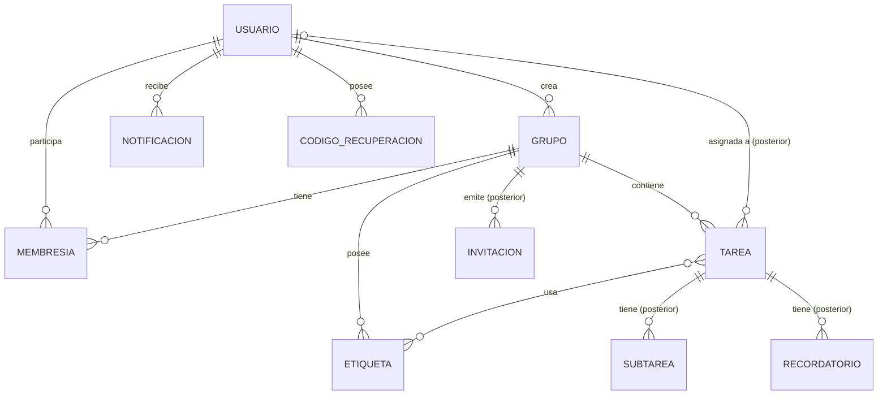

# Especificación de Requisitos de Software (SRS)

**Nombre del Proyecto:** Task by Task  
**Versión:** 1.0  
**Fecha:** 13/10/2026  
**Autores:** Cristhian  
**Organización / Cliente:** Proyecto personal de portafolio  

---

## Control de Versiones

| Versión | Fecha | Autor | Descripción del Cambio |
| :--- | :--- | :--- | :--- |
| 1.0 | 13/10/2026 | Cristhian | Versión inicial, derivada del SVD v1.0 (`TaskByTask-SVD.md`). |

---

## Tabla de Contenidos

1. [Introducción](#1-introducción)
   - 1.1 [Propósito](#11-propósito)
   - 1.2 [Alcance del Producto](#12-alcance-del-producto)
   - 1.3 [Definiciones, Acrónimos y Abreviaturas](#13-definiciones-acrónimos-y-abreviaturas)
   - 1.4 [Referencias](#14-referencias)
   - 1.5 [Visión General del Documento](#15-visión-general-del-documento)
2. [Descripción General](#2-descripción-general)
   - 2.1 [Perspectiva del Producto](#21-perspectiva-del-producto)
   - 2.2 [Funciones del Sistema](#22-funciones-del-sistema)
   - 2.3 [Clases y Características de Usuarios](#23-clases-y-características-de-usuarios)
   - 2.4 [Entorno Operativo](#24-entorno-operativo)
   - 2.5 [Restricciones de Diseño e Implementación](#25-restricciones-de-diseño-e-implementación)
   - 2.6 [Suposiciones y Dependencias](#26-suposiciones-y-dependencias)
3. [Requisitos Específicos](#3-requisitos-específicos)
   - 3.1 [Requisitos Funcionales (RF)](#31-requisitos-funcionales-rf)
   - 3.2 [Requisitos de Interfaces Externas](#32-requisitos-de-interfaces-externas)
   - 3.3 [Requisitos No Funcionales (RNF)](#33-requisitos-no-funcionales-rnf)
4. [Apéndices](#4-apéndices)

---

## 1. Introducción

### 1.1 Propósito
Este documento especifica los requisitos de software de **Task by Task**, versión 1.0 del análisis. Está dirigido al autor y desarrollador del proyecto, a quien lo evalúe como portafolio, y a quien diseñe, implemente o pruebe el sistema. Cada requisito está marcado con su **fase**:

- **MVP:** se implementa en la versión inicial.
- **Posterior:** está definido y aprobado, pero se implementa en versiones posteriores.

### 1.2 Alcance del Producto
**Task by Task** es una plataforma web (responsive, Mobile-First, solo en español) para gestionar tareas pendientes.

- **Qué hará (MVP):** permitir a un usuario con cuenta crear y gestionar tareas organizadas en grupos individuales y etiquetas, completarlas, buscarlas con filtros básicos y recibir avisos del navegador cuando llegue la fecha de caducidad.
- **Qué hará (posterior):** compartir grupos de tareas con hasta 4 personas más mediante roles, asignar tareas, usar subtareas y recordatorios previos, aplicar filtros avanzados, enviar invitaciones y avisos por correo y ofrecer un Panel de métricas al Analista.
- **Qué no hará:** prioridades de tareas, colores personalizados, otras plataformas, otros idiomas, monetización ni grupos de más de 5 personas (ver SVD 3.3).
- **Beneficio:** que el usuario deje de depender de su memoria, de terceros o de anotaciones dispersas para recordar sus tareas.

### 1.3 Definiciones, Acrónimos y Abreviaturas

| Término / Acrónimo | Definición |
| :--- | :--- |
| **SRS** | Software Requirements Specification (Especificación de Requisitos de Software). |
| **SVD** | Documento de Visión y Alcance. |
| **MVP** | Producto mínimo viable: versión inicial del producto. |
| **RF / RNF** | Requisito Funcional / Requisito No Funcional. |
| **Tarea** | Elemento a realizar, con título, fecha de caducidad opcional y estado. |
| **Subtarea** | Elemento de la lista de una tarea principal, de un solo nivel. |
| **Grupo** | Contenedor de tareas. Cada tarea pertenece a un único grupo. |
| **Grupo individual** | Grupo con una sola persona (el creador). No tiene miembros, roles ni asignación. |
| **Grupo compartido** | Grupo con 2 a 5 personas. Tiene miembros, roles y asignación. |
| **Grupo "Personal"** | Grupo individual creado por defecto a cada usuario. Se puede renombrar, pero no eliminar ni compartir. |
| **Etiqueta** | Rótulo opcional de una tarea. Pertenece al grupo, no al usuario. |
| **Creador / Gestor / Visitante** | Roles de un miembro dentro de un grupo compartido (ver RF-09). |
| **Analista** | Rol del sistema, independiente de los roles de grupo, con acceso de solo lectura a métricas. |
| **Asignación** | Designación de una persona de un grupo compartido para una tarea. Es opcional y de una sola persona. |
| **Tarea sin asignar / huérfana** | Tarea de un grupo compartido sin persona asignada. |
| **Fecha de caducidad** | Fecha, con hora opcional, en que se espera finalizar la tarea. |
| **Vencida** | Tarea pendiente cuya fecha de caducidad ya pasó. Sin hora, vence al terminar ese día en la zona horaria del usuario. |
| **Recordatorio** | Aviso previo a la fecha de caducidad (15 min, 30 min, 1 h, 6 h o 1 día antes). |
| **Centro de notificaciones** | Sección de la plataforma donde se listan los avisos del usuario. |
| **Código de recuperación** | Código de un solo uso para restablecer la contraseña sin correo. |
| **Mejor esfuerzo** | El sistema intenta realizar la acción con el mecanismo estándar, pero no garantiza el resultado y su fallo no se considera un defecto. |
| **Filtro principal** | Selección entre pendientes, completadas o todas. |

### 1.4 Referencias
- `TaskByTask-SVD.md`: Documento de Visión y Alcance de Task by Task v1.0.
- ISO/IEC/IEEE 29148: Ingeniería de requisitos.

### 1.5 Visión General del Documento
La sección 2 describe el producto y su contexto. La sección 3 detalla los requisitos funcionales por módulo, las interfaces externas y los requisitos no funcionales. Los apéndices incluyen la matriz de trazabilidad, el modelo de datos conceptual, las reglas de visibilidad y filtrado con ejemplos, y las limitaciones y supuestos.

---

## 2. Descripción General

### 2.1 Perspectiva del Producto
Task by Task es un sistema **independiente**, accesible desde el navegador. No reemplaza a otro sistema ni depende de integraciones externas en el MVP. Usa el mecanismo de notificaciones del navegador para los avisos. En versiones posteriores se integrará con un servicio de envío de correo electrónico.

### 2.2 Funciones del Sistema
- **MVP:** cuentas y acceso, grupos individuales, tareas (crear, editar, eliminar, completar, mover y copiar), etiquetas por grupo, filtros básicos (principal, título y grupo), aviso de caducidad y centro de notificaciones.
- **Posterior:** grupos compartidos, roles, invitaciones, asignación, subtareas, recordatorios, tareas que se repiten, filtros avanzados, funciones por correo, Panel de métricas y mejoras de experiencia.

### 2.3 Clases y Características de Usuarios

| Perfil de Usuario | Nivel Técnico | Descripción de Responsabilidades / Rol | Fase |
| :--- | :---: | :--- | :---: |
| **Usuario** | Básico | Gestiona sus grupos, tareas y etiquetas. Es creador de sus grupos. | MVP |
| **Creador de grupo compartido** | Básico | Renombra y elimina el grupo, invita y expulsa, cambia roles y hace todo lo del gestor. | Posterior |
| **Gestor** | Básico | Crea, modifica y elimina tareas y etiquetas, asigna tareas y completa cualquier tarea. | Posterior |
| **Visitante** | Básico | Ve las tareas del grupo y completa las asignadas a él. Es el rol por defecto al unirse. | Posterior |
| **Analista** | Medio | Consulta métricas globales. Su cuenta se crea solo desde el backend. | Posterior |

### 2.4 Entorno Operativo
- **Plataformas:** navegadores de escritorio y móvil, últimas dos versiones estables de Google Chrome, Microsoft Edge y Mozilla Firefox. Diseño responsive Mobile-First. Sin aplicaciones nativas.
- **Servidores y base de datos:** sin definir. El diseño es agnóstico a la tecnología.

### 2.5 Restricciones de Diseño e Implementación
- Interfaz solo en **español**.
- Tecnología **agnóstica**: no se fija lenguaje, base de datos, proveedor ni infraestructura.
- Producto **gratuito**, sin monetización.
- Las reglas de negocio y los límites se validan siempre en el **backend**, no solo en la interfaz.
- El diseño del MVP debe permitir incorporar grupos compartidos, subtareas y recordatorios sin rehacer lo existente (RNF-20).

### 2.6 Suposiciones y Dependencias
- *Suposición:* los usuarios dispondrán de conexión a internet y de un navegador compatible.
- *Suposición:* los usuarios conceden el permiso de notificaciones del navegador para recibir avisos.
- *Suposición:* el mínimo del título de una subtarea no se definió. Se asume 1 carácter.
- *Dependencia:* el mecanismo de notificaciones del navegador. En iPhone los avisos con el navegador cerrado requieren instalar el sitio en la pantalla de inicio (mejor esfuerzo).
- *Dependencia (posterior):* un servicio de envío de correo electrónico.

---

## 3. Requisitos Específicos

### 3.1 Requisitos Funcionales (RF)

> **Convenciones:**
> - Los límites de longitud y cantidad están consolidados en el [Apéndice B](#apéndice-b-modelo-de-datos-conceptual-y-límites).
> - Prioridad: Alta, Media o Baja.
> - Fase: MVP o Posterior.

#### 3.1.1 Cuentas y acceso

#### RF-01: Registro de usuario
- **Código:** RF-01
- **Nombre:** Registro de usuario
- **Fase / Prioridad:** MVP / Alta
- **Descripción:** El sistema debe permitir crear una cuenta.
- **Entradas:**
  - Correo electrónico.
  - Nombre de usuario (3 a 30 caracteres, letras A-Z y números).
  - Nombre para mostrar (2 a 50 caracteres).
  - Contraseña (6 a 30 caracteres).
- **Procesamiento:**
  - Validar formato y longitudes.
  - Validar que el correo y el nombre de usuario sean únicos. El nombre de usuario no distingue mayúsculas.
  - Crear la cuenta y el grupo "Personal".
  - Guardar la zona horaria del navegador.
  - Establecer el formato de hora en 24 horas.
  - Generar 8 códigos de recuperación de un solo uso.
- **Salidas:**
  - Cuenta creada con sesión iniciada.
  - Códigos de recuperación mostrados **una sola vez**, con la indicación de guardarlos.
  - Mensajes de error claros por cada validación fallida.
- **Nota:** no hay verificación de correo en el MVP (limitación conocida, ver RF-11).

#### RF-02: Inicio y cierre de sesión
- **Código:** RF-02
- **Nombre:** Inicio y cierre de sesión
- **Fase / Prioridad:** MVP / Alta
- **Descripción:** El sistema debe permitir iniciar sesión con correo y contraseña, y cerrarla.
- **Entradas:** correo electrónico y contraseña.
- **Procesamiento:**
  - Validar las credenciales.
  - Limitar los intentos fallidos consecutivos.
  - Mantener la sesión hasta 7 días.
  - Al iniciar sesión, actualizar la zona horaria desde el navegador.
  - Al cerrar sesión en un dispositivo, dejar de enviarle avisos del navegador.
- **Salidas:** acceso a la plataforma o mensaje de error genérico sin revelar si el correo existe.

#### RF-03: Recuperación de contraseña con códigos
- **Código:** RF-03
- **Nombre:** Recuperación de contraseña con códigos de recuperación
- **Fase / Prioridad:** MVP / Media
- **Descripción:** El sistema debe permitir restablecer la contraseña sin correo, mediante los códigos de recuperación.
- **Entradas:** correo de la cuenta, un código de recuperación y la nueva contraseña (6 a 30 caracteres).
- **Procesamiento:**
  - Validar el código y consumirlo, porque es de un solo uso.
  - Actualizar la contraseña.
- **Salidas:** contraseña restablecida o mensaje de error. Si el usuario agotó o perdió los códigos, no hay forma de recuperar el acceso en el MVP.

#### RF-04: Perfil y preferencias
- **Código:** RF-04
- **Nombre:** Perfil y preferencias
- **Fase / Prioridad:** MVP / Media
- **Descripción:** El sistema debe permitir al usuario editar sus datos y preferencias.
- **Entradas:** nombre para mostrar, nombre de usuario, correo, contraseña, formato de hora y solicitud de regeneración de códigos.
- **Procesamiento:**
  - Aplicar las mismas validaciones del registro.
  - Para cambiar la contraseña, exigir la **contraseña actual**.
  - El formato de hora es una preferencia por usuario (24 h por defecto, intercambiable con 12 h) y aplica a la visualización y a la captura de horas.
  - Regenerar los códigos de recuperación exige la contraseña e invalida los anteriores.
  - La zona horaria se obtiene automáticamente del navegador al iniciar sesión.
- **Salidas:** datos actualizados o errores de validación.

#### RF-05: Eliminación de cuenta
- **Código:** RF-05
- **Nombre:** Eliminación de cuenta
- **Fase / Prioridad:** MVP / Media
- **Descripción:** El sistema debe permitir eliminar la cuenta de forma definitiva.
- **Entradas:** confirmación y contraseña.
- **Procesamiento:**
  - Advertir previamente que se eliminarán los grupos del usuario, con sus tareas y etiquetas.
  - Eliminar la cuenta y sus datos personales.
  - **Posterior:** si el usuario es creador de grupos compartidos, se eliminan esos grupos y se notifica a los miembros (ver RF-30). En los grupos donde es gestor o visitante, abandona el grupo: sus tareas asignadas quedan sin asignar y se notifica la salida a los demás miembros.
- **Salidas:** cuenta eliminada y sesión cerrada.

#### 3.1.2 Grupos

#### RF-06: Grupo "Personal" y grupos individuales
- **Código:** RF-06
- **Nombre:** Grupo "Personal" y grupos individuales
- **Fase / Prioridad:** MVP / Alta
- **Descripción:** Cada usuario debe tener el grupo "Personal" por defecto y poder crear otros grupos individuales sin límite.
- **Entradas:** nombre del grupo (3 a 30 caracteres).
- **Procesamiento:**
  - El grupo "Personal" se crea con la cuenta, es individual y no se puede eliminar ni compartir. Sí se puede renombrar.
  - Los grupos creados por el usuario son individuales y el usuario es su creador.
  - Un grupo individual no ofrece miembros, roles ni asignación de tareas, y la interfaz no muestra esas funciones.
- **Salidas:** grupo creado y visible en la vista de grupos (RF-24).

#### RF-07: Renombrar y eliminar grupos
- **Código:** RF-07
- **Nombre:** Renombrar y eliminar grupos
- **Fase / Prioridad:** MVP / Media
- **Descripción:** El creador debe poder renombrar un grupo y eliminar los grupos distintos de "Personal".
- **Entradas:** nuevo nombre (3 a 30 caracteres) o confirmación de eliminación.
- **Procesamiento:**
  - Al eliminar, advertir previamente.
  - Se eliminan en cascada las tareas, subtareas y etiquetas del grupo.
  - **Posterior:** en grupos compartidos, notificar la eliminación a los miembros (ver RF-30).
- **Salidas:** grupo renombrado o eliminado.

#### RF-08: Grupos compartidos
- **Código:** RF-08
- **Nombre:** Grupos compartidos
- **Fase / Prioridad:** Posterior / Alta
- **Descripción:** Un grupo individual (distinto de "Personal") debe poder convertirse en compartido.
- **Procesamiento:**
  - **Conversión a compartido:** al aceptar la primera invitación (el grupo pasa a tener 2 personas).
  - **Vuelta a individual:** si el creador expulsa a todos los miembros, o si todos se van, el grupo vuelve a ser **individual** (no se convierte en "Personal"). Las tareas con asignado quedan sin asignar, y la interfaz deja de mostrar miembros, roles y asignación.
  - **Capacidad:** de 2 a 5 personas, incluido el creador. Con el grupo lleno, la interfaz **oculta** toda opción de invitar, y el backend rechaza igualmente la unión con un error controlado ("el grupo está lleno").
  - **Funciones exclusivas del grupo compartido:** ver miembros, cambiar roles, expulsar o agregar personas, y asignar tareas.
  - **Tareas existentes:** las tareas de un grupo individual quedan **sin asignar** al volverse compartido (no se asignan automáticamente al creador). Antes de enviar la primera invitación a un grupo individual con tareas, se advierte que esas tareas quedarán sin asignar y dejarán de generar avisos.
- **Salidas:** grupo compartido con sus funciones, o error controlado.

#### RF-09: Roles y permisos
- **Código:** RF-09
- **Nombre:** Roles y permisos
- **Fase / Prioridad:** Posterior / Alta
- **Descripción:** Un grupo compartido debe tener tres roles con permisos **completos y cerrados**. No existen permisos parciales: quien tiene un rol puede hacer exactamente lo de ese rol, ni más ni menos.
- **Matriz de permisos:**

| Acción | Visitante | Gestor | Creador |
| :--- | :---: | :---: | :---: |
| Ver miembros del grupo | ✔ | ✔ | ✔ |
| Ver todas las tareas del grupo | ✔ | ✔ | ✔ |
| Completar o desmarcar sus tareas asignadas | ✔ | ✔ | ✔ |
| Completar o desmarcar tareas ajenas o sin asignar | ✘ | ✔ | ✔ |
| Crear, modificar y eliminar tareas | ✘ | ✔ | ✔ |
| Agregar, quitar, modificar y eliminar etiquetas | ✘ | ✔ | ✔ |
| Asignar tareas (a creador, gestores o visitantes) | ✘ | ✔ | ✔ |
| Renombrar o eliminar el grupo | ✘ | ✘ | ✔ |
| Invitar, expulsar y cambiar el rol de miembros | ✘ | ✘ | ✔ |
| Abandonar el grupo | ✔ | ✔ | ✘ (solo puede eliminarlo) |

- **Procesamiento:**
  - El rol por defecto al unirse es **visitante**.
  - Solo hay **un creador**: no se transfiere el cargo ni hay co-creadores.
  - El creador puede cambiar el rol de los demás.
  - Al expulsar a alguien con tareas asignadas, se advierte al creador. Al confirmar, esas tareas quedan sin asignar.
- **Salidas:** acciones permitidas o errores controlados por permiso insuficiente.

#### RF-10: Invitaciones dentro de la plataforma
- **Código:** RF-10
- **Nombre:** Invitaciones dentro de la plataforma
- **Fase / Prioridad:** Posterior / Alta
- **Descripción:** El creador debe poder invitar a usuarios **registrados** a un grupo, buscándolos por correo o nombre de usuario exactos.
- **Procesamiento:**
  - **Usuario existente:** se pulsa "Invitar usuario" y se muestra "Invitado". La invitación llega al centro de notificaciones del invitado, que puede aceptar o rechazar.
  - **Usuario inexistente:** se informa que no existe y el botón queda deshabilitado.
  - **Caducidad:** 24 horas. No se puede volver a invitar a la misma persona mientras haya una invitación pendiente. Tras caducar, sí.
  - **Rechazo o expulsión previa:** una persona que rechazó, o que fue expulsada, puede ser invitada de nuevo sin esperar las 24 horas.
  - **Cupo:** una invitación **no reserva cupo**. Quien acepte primero ocupa el último lugar. Si el grupo ya está lleno al aceptar, se muestra un error controlado.
  - **Restricciones:** no se puede invitar a uno mismo.
  - **Rol al unirse:** visitante.
  - **Notificaciones:** aceptación, rechazo y caducidad se notifican al creador. La llegada de un miembro se notifica a todos (ver RF-30).
- **Salidas:** invitación enviada, aceptada, rechazada o caducada.

#### RF-11: Funciones por correo electrónico
- **Código:** RF-11
- **Nombre:** Funciones por correo electrónico
- **Fase / Prioridad:** Posterior / Baja
- **Descripción:** El sistema debe incorporar funciones que usan correo electrónico, hoy fuera del MVP:
  - **Invitar a personas sin cuenta:** al ingresar un correo no registrado, el botón cambia a "Enviar invitación por correo". La persona recibe un enlace. Al abrirlo, si no tiene cuenta, debe crear una para unirse al grupo. Al invitar se muestra "Invitado", con la misma restricción de 24 horas.
  - **Verificación de correo:** al registrarse.
  - **Recuperación de contraseña por correo.**
- **Salidas:** correos enviados y flujos completados.

#### 3.1.3 Tareas

#### RF-12: Crear tarea
- **Código:** RF-12
- **Nombre:** Crear tarea
- **Fase / Prioridad:** MVP / Alta
- **Descripción:** El sistema debe permitir crear una tarea dentro de un grupo.
- **Entradas:**
  - Título (obligatorio, 2 a 100 caracteres).
  - Descripción (opcional, hasta 750 caracteres).
  - Fecha de caducidad (opcional).
  - Hora de caducidad (opcional, solo si hay fecha).
  - Etiquetas (opcional, ver RF-22).
  - Grupo.
- **Procesamiento:**
  - Asignar un identificador único y la fecha de creación automática (no editable).
  - Dejar el estado en pendiente.
  - No hay restricción para fechas pasadas, de hoy o futuras. Una tarea creada con fecha ya pasada nace vencida.
- **Salidas:** tarea creada en el grupo. **Posterior:** también admite persona asignada (RF-19), subtareas (RF-18) y recordatorios (RF-20).

#### RF-13: Editar y eliminar tarea
- **Código:** RF-13
- **Nombre:** Editar y eliminar tarea
- **Fase / Prioridad:** MVP / Alta
- **Descripción:** El sistema debe permitir modificar y eliminar tareas.
- **Entradas:** campos editables (título, descripción, fecha y hora de caducidad, etiquetas) o confirmación de eliminación.
- **Procesamiento:**
  - Aplicar las mismas validaciones del RF-12.
  - Al cambiar la fecha o la hora de caducidad, se recalculan los avisos programados (RF-28).
  - Al eliminar, también se eliminan sus subtareas y avisos pendientes.
  - **Posterior:** las acciones dependen del rol (RF-09).
- **Salidas:** tarea actualizada o eliminada.

#### RF-14: Completar, desmarcar y estado visual
- **Código:** RF-14
- **Nombre:** Completar, desmarcar y estado visual de la tarea
- **Fase / Prioridad:** MVP / Alta
- **Descripción:** El sistema debe permitir marcar una tarea como completada y desmarcarla.
- **Procesamiento:**
  - Al completar, se guarda la fecha en que se completó. Al desmarcar, la tarea vuelve a pendiente.
  - Al completar, se cancelan sus avisos pendientes. Al desmarcar, si su fecha sigue en el futuro, los avisos se recalculan.
  - **Pendiente vencida:** se muestra en **rojo**, con un texto o ícono "Vencida", para no depender solo del color.
  - **Completada:** se muestra **tachada**.
  - **Completada que estaba vencida:** se muestra solo tachada, sin rojo.
  - Una tarea con fecha pero **sin hora** se considera vencida al terminar ese día en la zona horaria del usuario.
  - **Posterior:** cualquier rol con permiso puede desmarcar, según RF-09.
- **Salidas:** estado actualizado e indicación visual.

#### RF-15: Orden de las tareas
- **Código:** RF-15
- **Nombre:** Orden de las tareas
- **Fase / Prioridad:** MVP / Media
- **Descripción:** Las tareas deben mostrarse con un orden fijo por defecto.
- **Procesamiento:**
  - Orden ascendente por fecha de caducidad.
  - Las tareas **sin fecha** van al final, ordenadas por fecha de creación.
  - Con el filtro principal "todas", las completadas van **al final**.
- **Salidas:** listas ordenadas.

#### RF-16: Mover y copiar entre grupos individuales
- **Código:** RF-16
- **Nombre:** Mover y copiar entre grupos individuales
- **Fase / Prioridad:** MVP / Media
- **Descripción:** El sistema debe permitir mover o copiar una tarea a otro grupo individual desde el menú de opciones de la tarea (tres puntos), con las opciones "Mover a…" y "Copiar a…".
- **Entradas:** tarea y grupo destino.
- **Procesamiento:**
  - **Mover:** la tarea cambia de grupo y conserva su fecha de creación original.
  - **Copiar:** el grupo de origen conserva la tarea. La copia duplica todas sus propiedades (título, descripción, fecha de caducidad, estado y etiquetas) y recibe una **nueva fecha de creación**.
  - Las etiquetas se reutilizan por nombre en el grupo destino. Las que no existan se crean.
  - Solo se ofrecen como destino los grupos individuales del usuario.
  - Arrastrar y soltar no está disponible en el MVP (RF-33).
- **Salidas:** tarea movida o copiada.

#### RF-17: Mover y copiar con grupos compartidos
- **Código:** RF-17
- **Nombre:** Mover y copiar con grupos compartidos
- **Fase / Prioridad:** Posterior / Media
- **Descripción:** Mover y copiar debe extenderse a grupos compartidos.
- **Procesamiento:**
  - **Destino:** solo grupos donde el usuario es **creador** (incluye los individuales), aunque sea gestor en otros.
  - **Copiar:** cualquier miembro puede copiar las tareas que ve.
  - **Mover:** solo gestor o creador del grupo de origen.
  - **Asignado ausente del destino:**
    - Si el destino es "Personal" (o un grupo sin esa persona y no compartible), la tarea queda **sin asignar** con un aviso, sin ofrecer invitar.
    - Si el destino es otro grupo individual o compartido, se advierte que la persona asignada no es miembro y se ofrece **invitarla**. Si el creador acepta, la tarea queda sin asignar hasta que la persona entre. Al unirse, se le **asigna automáticamente**. Si rechaza invitarla, la tarea queda sin asignar y, si el destino es individual, pierde la función de asignación.
  - Si el destino ya está lleno, la invitación no puede enviarse (ver RF-08).
  - La interfaz solo muestra grupos destino válidos para el usuario.
- **Salidas:** tarea movida o copiada con las advertencias correspondientes.

#### RF-18: Subtareas
- **Código:** RF-18
- **Nombre:** Subtareas
- **Fase / Prioridad:** Posterior / Media
- **Descripción:** Una tarea debe poder tener una lista de subtareas de un solo nivel.
- **Entradas:** título de la subtarea (hasta 50 caracteres). Máximo 25 subtareas por tarea.
- **Procesamiento:**
  - Las subtareas no tienen propiedades propias, solo título y estado completado.
  - Completar la tarea principal completa todas sus subtareas.
  - Completar todas las subtareas completa la principal.
  - Desmarcar una subtarea, o agregar una a una tarea completada, devuelve la principal a **pendiente**.
  - **Borrar subtareas:**
    - Si quedan subtareas y todas están completadas, la principal pasa a completada.
    - Si se borra la única subtarea, la tarea pasa a ser una tarea normal y conserva su estado.
  - Al copiar una tarea, se copian sus subtareas.
  - Marcar subtareas sigue los mismos permisos que completar la tarea (RF-09).
- **Salidas:** subtareas y estado de la tarea principal consistentes.

#### RF-19: Asignación de tareas
- **Código:** RF-19
- **Nombre:** Asignación de tareas
- **Fase / Prioridad:** Posterior / Alta
- **Descripción:** En un grupo compartido, las tareas deben poder asignarse a una persona. La asignación es opcional, de **una sola persona**, y puede recaer en el creador, un gestor o un visitante.
- **Procesamiento:**
  - Solo gestor y creador asignan.
  - Una tarea sin asignar puede existir. La ven todos los miembros del grupo, y solo gestor y creador pueden completarla.
  - Los grupos individuales no ofrecen asignación.
  - Al asignar, se notifica a la persona asignada. Al quitarle una tarea (por reasignación o expulsión), se le notifica (ver RF-30).
- **Salidas:** tarea asignada o sin asignar.

#### RF-20: Recordatorios previos
- **Código:** RF-20
- **Nombre:** Recordatorios previos
- **Fase / Prioridad:** Posterior / Media
- **Descripción:** Una tarea con fecha **y hora** de caducidad debe poder tener hasta 5 recordatorios previos, no personalizables: 15 minutos, 30 minutos, 1 hora, 6 horas y 1 día antes.
- **Procesamiento:**
  - Sin fecha o sin hora, la opción no está disponible ni se muestra.
  - El sistema valida y no permite seleccionar un recordatorio cuya hora ya pasó al momento de configurarlo.
  - Al cambiar la fecha o la hora se recalculan. Al completar la tarea se cancelan.
  - Solo se notifica a la persona asignada (o al dueño en grupos individuales).
- **Salidas:** avisos programados.

#### RF-21: Tareas que se repiten
- **Código:** RF-21
- **Nombre:** Tareas que se repiten
- **Fase / Prioridad:** Posterior / Baja
- **Descripción:** El sistema debe permitir que una tarea se repita (por ejemplo, "todos los jueves a las 5 PM").
- **Procesamiento:** la interfaz no muestra el nombre de la propiedad. Solo indica "Se repetirá: [fecha]". Su definición detallada se completará antes de implementarlo.
- **Salidas:** tarea con repetición.

#### 3.1.4 Etiquetas

#### RF-22: Etiquetas en tareas
- **Código:** RF-22
- **Nombre:** Etiquetas en tareas
- **Fase / Prioridad:** MVP / Media
- **Descripción:** Las tareas deben poder tener etiquetas opcionales, que pertenecen al **grupo** de la tarea.
- **Entradas:** texto de la etiqueta (1 a 30 caracteres).
- **Procesamiento:**
  - **Captura:** en el campo de etiquetas de la tarea, la etiqueta se crea al escribir `;` o `,`, y el cursor pasa a la siguiente. Los caracteres `;` y `,` no forman parte del nombre.
  - **Sugerencias:** al escribir se sugieren las etiquetas existentes del grupo.
  - **Duplicados:** dos nombres iguales, sin distinguir mayúsculas ni espacios, son la misma etiqueta. Si ya existe, se reutiliza, y no se muestra aviso.
  - **Independencia:** las etiquetas existen aunque no estén en ninguna tarea. No pertenecen a un usuario, así que se conservan si quien las creó sale del grupo.
  - **Editar desde una tarea:** reescribir una etiqueta en la tarea la **reemplaza solo en esa tarea**.
  - **Quitar de una tarea:** muestra una ventana que pregunta si se elimina **solo de la tarea** o también **del grupo** (y por tanto de todas sus tareas).
  - **Visualización:** la tarjeta de la tarea muestra las primeras 5 etiquetas y el detalle muestra todas.
  - **Posterior:** en grupos compartidos, crear, modificar y eliminar etiquetas lo hacen gestor y creador (RF-09), y todos los miembros las ven.
- **Salidas:** etiquetas asociadas a la tarea.

#### RF-23: Pantalla de etiquetas del grupo
- **Código:** RF-23
- **Nombre:** Pantalla de gestión de etiquetas
- **Fase / Prioridad:** Posterior / Baja
- **Descripción:** El sistema debe ofrecer una pantalla por grupo para ver, renombrar y eliminar sus etiquetas, incluidas las que no se usan en ninguna tarea. Hasta entonces, las etiquetas sin uso permanecen en el grupo.
- **Salidas:** catálogo de etiquetas del grupo gestionable.

#### 3.1.5 Visualización, búsqueda y filtros

#### RF-24: Vista de grupos
- **Código:** RF-24
- **Nombre:** Vista de grupos
- **Fase / Prioridad:** MVP / Alta
- **Descripción:** La vista por defecto debe mostrar todos los grupos del usuario en una cuadrícula, cada uno con sus tareas según el filtro principal activo.
- **Procesamiento:**
  - Un grupo compartido muestra todas sus tareas a todos sus miembros, sin importar su rol ni la asignación.
  - Con el filtro de grupo (RF-25), la cuadrícula muestra solo los grupos elegidos.
  - Se refresca manualmente (recargando la página o con un botón de refresco incorporado). No hay actualización en tiempo real (RF-33).
- **Salidas:** cuadrícula de grupos con sus tareas.

#### RF-25: Filtros básicos
- **Código:** RF-25
- **Nombre:** Filtros básicos
- **Fase / Prioridad:** MVP / Alta
- **Descripción:** El sistema debe ofrecer filtros combinables.
- **Entradas:** filtro principal, texto de título y uno o varios grupos.
- **Procesamiento:**
  - **Filtro principal:** pendientes (por defecto), completadas o todas.
  - **Título:** coincidencia parcial, sin distinguir mayúsculas ni minúsculas, solo sobre el título.
  - **Grupo:** permite seleccionar uno o varios grupos. Los filtros se combinan entre sí.
  - **Búsqueda sin grupo (MVP):** al buscar por título sin elegir grupo, se busca en todos los grupos del usuario. Como todos son individuales, todas las tareas son suyas.
- **Salidas:** tareas que cumplen todos los filtros activos.

#### RF-26: Filtros avanzados
- **Código:** RF-26
- **Nombre:** Filtros avanzados
- **Fase / Prioridad:** Posterior / Media
- **Descripción:** El sistema debe agregar filtros por rango de fechas y por etiqueta, y la regla de visibilidad de la vista de resultados.
- **Procesamiento:**
  - **Rango de fechas:**
    - Aplica sobre el filtro principal activo (pendientes, completadas o todas).
    - Se elige el tipo de fecha: *creadas* o *por terminar* (fecha de caducidad), tanto para pendientes como para completadas.
    - La comparación usa solo la fecha, sin la hora, en la zona horaria del usuario.
    - En *creadas* no se aceptan fechas futuras.
    - Las tareas sin fecha de caducidad se **excluyen** del rango *por terminar*.
    - Se permite un rango abierto (solo "desde" o solo "hasta").
    - Si la fecha final es anterior a la inicial, se muestra un mensaje bajo el campo y el filtro no se ejecuta hasta corregirlo. Una fecha final igual a la inicial es válida.
  - **Etiqueta:**
    - Solo se habilita cuando hay **exactamente un grupo** seleccionado. Con varios grupos no se puede filtrar por etiqueta.
    - Con varias etiquetas, una tarea coincide si tiene **al menos una** de ellas.
    - Se combina con el filtro principal.
  - **Vista de resultados:**
    - Se activa al usar título o rango de fechas **sin elegir grupo**.
    - Muestra una lista única con solo las tareas **asignadas al usuario** en grupos compartidos, más todas las de sus grupos individuales. Las tareas no asignadas al usuario no se incluyen.
    - Si se elige uno o varios grupos, se muestran todas las tareas del grupo que cumplan los filtros.
  - Ver ejemplos en el [Apéndice C](#apéndice-c-reglas-de-visibilidad-y-casos-de-filtrado).
- **Salidas:** tareas que cumplen los filtros.

#### 3.1.6 Notificaciones

#### RF-27: Avisos del navegador
- **Código:** RF-27
- **Nombre:** Avisos del navegador
- **Fase / Prioridad:** MVP / Alta
- **Descripción:** El sistema debe enviar avisos mediante el mecanismo de notificaciones del navegador, tanto con la plataforma abierta como, en lo posible, con el navegador cerrado.
- **Procesamiento:**
  - **Permiso:** si el usuario no lo ha concedido, se muestra un aviso discreto al abrir la plataforma, como máximo una vez cada 8 horas. Si el navegador bloqueó el permiso, el aviso incluye instrucciones para reactivarlo.
  - **Varios dispositivos:** el aviso llega a todos los dispositivos con sesión iniciada y permiso concedido. Al cerrar sesión en un dispositivo, deja de recibirlos ahí.
  - **Garantía:** es de **mejor esfuerzo**. No se garantiza con el dispositivo apagado, con el navegador cerrado sin permiso, ni en iPhone si el sitio no está instalado en la pantalla de inicio.
  - Todo aviso queda además registrado en el centro de notificaciones (RF-29).
  - **Eventos con aviso del navegador:** en el MVP, la caducidad (RF-28). **Posterior:** recordatorios, asignación de tareas e invitaciones. El resto de eventos solo aparece dentro de la plataforma.
- **Salidas:** aviso del navegador entregado cuando es técnicamente posible.

#### RF-28: Aviso de caducidad
- **Código:** RF-28
- **Nombre:** Aviso de caducidad
- **Fase / Prioridad:** MVP / Alta
- **Descripción:** El sistema debe avisar al usuario cuando llegue la fecha y hora de caducidad de una tarea suya.
- **Procesamiento:**
  - **Con hora:** se avisa en el momento exacto o lo antes posible. Un retraso de pocos minutos es aceptable.
  - **Solo con fecha:** se avisa a las **9:00 hora local** del usuario (según su zona horaria) del día de la fecha. Si se crea o edita para hoy cuando ya pasaron las 9:00, se avisa de inmediato.
  - **Sin fecha:** nunca se avisa.
  - **Destinatario (MVP):** el dueño del grupo individual.
  - **Posterior:** solo la persona asignada. Las tareas sin asignar de un grupo compartido no avisan a nadie.
  - Al cambiar la fecha o la hora, se recalcula. Al completar la tarea, el aviso se cancela. Si se desmarca y su fecha sigue en el futuro, se vuelve a programar.
- **Salidas:** aviso del navegador y entrada en el centro de notificaciones.

#### RF-29: Centro de notificaciones
- **Código:** RF-29
- **Nombre:** Centro de notificaciones
- **Fase / Prioridad:** MVP / Media
- **Descripción:** El sistema debe ofrecer un centro de notificaciones dentro de la plataforma.
- **Procesamiento:**
  - Cada notificación puede marcarse como leída y borrarse.
  - Las notificaciones se conservan **un mes** y luego se eliminan automáticamente.
  - **Evento en el MVP:** tarea caducada.
- **Salidas:** lista de notificaciones del usuario.

#### RF-30: Eventos de colaboración y recordatorios
- **Código:** RF-30
- **Nombre:** Eventos de colaboración y recordatorios
- **Fase / Prioridad:** Posterior / Media
- **Descripción:** El centro de notificaciones debe incorporar los eventos de las funciones posteriores.

| Evento | Destinatario |
| :--- | :--- |
| Recordatorio previo de una tarea | Persona asignada |
| Tarea caducada (llegó a su límite) | Persona asignada (o dueño del grupo individual) |
| Invitación recibida | Invitado (usuario existente) |
| Invitación aceptada, rechazada o caducada | Creador |
| Llegada de un miembro al grupo | Todos los miembros |
| Abandono de un miembro | Todos los miembros |
| Cambio del propio rol | La persona afectada (no se notifica el cambio de rol de otros) |
| Asignación de una tarea | Persona asignada |
| Tarea quitada (desasignación o tarea huérfana) | Persona que la tenía |
| Expulsión del grupo | Persona expulsada |
| Tarea propia completada o desmarcada por otra persona | Persona asignada |
| Tarea asignada modificada o eliminada | Persona asignada |
| Eliminación de un grupo (por el creador) | Todos los miembros |
| Eliminación de la cuenta del creador | Todos los miembros (con el mismo detalle que la eliminación del grupo) |

- **Detalle de la eliminación de un grupo o cuenta:** a todos los miembros se les informa que el grupo ya no existe. Se avisa además sobre sus tareas solo a quienes tenían tareas asignadas en el momento de la eliminación, no a quienes nunca tuvieron una.
- **Salidas:** notificaciones generadas en el centro y, para los eventos indicados en RF-27, aviso del navegador.

#### 3.1.7 Métricas

#### RF-31: Acceso del Analista
- **Código:** RF-31
- **Nombre:** Acceso del Analista
- **Fase / Prioridad:** Posterior / Media
- **Descripción:** El Analista es un rol del sistema, independiente de los roles de grupo, con acceso de solo lectura.
- **Procesamiento:**
  - Su cuenta se crea **solo desde el backend**. No existe registro público para este rol.
  - Entra por un **inicio de sesión aparte**, distinto del de los usuarios, que lo lleva directamente al Panel de métricas.
- **Salidas:** sesión del Analista o error de credenciales.

#### RF-32: Panel de métricas
- **Código:** RF-32
- **Nombre:** Panel de métricas
- **Fase / Prioridad:** Posterior / Media
- **Descripción:** El sistema debe mostrar al Analista métricas globales agregadas.
- **Procesamiento:**
  - **Métricas:**
    - cantidad de usuarios registrados
    - tareas completadas
    - tareas pendientes
    - grupos individuales y grupos compartidos (por separado)
  - El Analista **no ve el contenido** de las tareas.
- **Salidas:** panel de solo lectura.

#### 3.1.8 Mejoras de experiencia

#### RF-33: Mejoras de experiencia
- **Código:** RF-33
- **Nombre:** Mejoras de experiencia
- **Fase / Prioridad:** Posterior / Baja
- **Descripción:** Mejoras aprobadas, para después del MVP:
  - arrastrar y soltar tareas entre grupos
  - actualización en tiempo real de los cambios de otras personas
  - búsqueda por descripción y por subtareas
- **Salidas:** funciones adicionales, sin alterar los requisitos del MVP.

---

### 3.2 Requisitos de Interfaces Externas

#### 3.2.1 Interfaces de Usuario (UI)
- **UI-01:** la interfaz es **responsive con enfoque Mobile-First**, y está en **español**.
- **UI-02:** en la vista por defecto se muestran los grupos del usuario en una cuadrícula, cada uno con sus tareas (RF-24).
- **UI-03:** las acciones de una tarea (incluidas "Mover a…" y "Copiar a…") se agrupan en un menú de opciones de tres puntos verticales.
- **UI-04:** una tarea pendiente vencida se muestra en rojo con un texto o ícono "Vencida". Una completada se muestra tachada (RF-14).
- **UI-05:** las funciones propias de grupos compartidos (miembros, roles, asignación, invitar) **no aparecen** en grupos individuales, ni la opción de invitar cuando el grupo está lleno.
- **UI-06:** las acciones destructivas (eliminar grupo, cuenta o etiqueta del grupo) piden confirmación y advierten sus consecuencias.
- **UI-07:** el formato de hora (24 h por defecto, o 12 h) se aplica a toda la plataforma según la preferencia del usuario.

#### 3.2.2 Interfaces de Software
- **Notificaciones del navegador:** mecanismo estándar del navegador para los avisos (RF-27). Su comportamiento depende del navegador y del sistema operativo.
- **Correo electrónico (posterior):** servicio de envío para invitaciones, verificación y recuperación (RF-11). No se fija proveedor.

#### 3.2.3 Interfaces de Comunicaciones
- Toda comunicación entre el navegador y el sistema debe ir por una conexión cifrada (RNF-08).

---

### 3.3 Requisitos No Funcionales (RNF)

#### 3.3.1 Rendimiento
- **RNF-01 (Tiempo de respuesta):** las acciones comunes (abrir la vista de grupos, crear, completar o filtrar una tarea) deben responder en **2 segundos o menos**.
- **RNF-02 (Capacidad):** el sistema debe funcionar sin degradación con **1.000 usuarios registrados** y unos **100 conectados simultáneamente**.
- **RNF-03 (Avisos):** los avisos de caducidad deben emitirse con un retraso de pocos minutos.
- **RNF-04 (Volumen):** como no hay límite de tareas, grupos ni etiquetas, las listas deben cargarse de forma progresiva.

#### 3.3.2 Seguridad
- **RNF-05 (Contraseñas):** las contraseñas deben almacenarse de forma no reversible.
- **RNF-06 (Intentos de acceso):** debe limitarse el número de intentos fallidos de inicio de sesión.
- **RNF-07 (Validación en el servidor):** los permisos, límites y reglas de negocio se validan siempre en el backend. Ante una infracción, se devuelve un **error controlado**.
- **RNF-08 (Cifrado en tránsito):** toda comunicación debe ir por conexión cifrada.
- **RNF-09 (Sesión):** la sesión dura hasta 7 días y puede cerrarse. Cambiar la contraseña y regenerar los códigos de recuperación exigen la contraseña actual.
- **RNF-10 (Privacidad):** al eliminar la cuenta se borran los datos personales del usuario. El Analista no accede al contenido de las tareas (posterior).

#### 3.3.3 Disponibilidad y Respaldo
- **RNF-11 (Respaldo):** copia automática diaria de los datos, conservada 7 días, con al menos una restauración de prueba.

#### 3.3.4 Usabilidad y Accesibilidad
- **RNF-12 (Accesibilidad básica):**
  - navegación con la tecla Tab
  - foco visible
  - campos de formulario etiquetados
  - contraste suficiente
  - no depender solo del color para indicar el estado (RF-14)
- **RNF-13 (Atajos de teclado):** no se incluyen atajos en esta versión.
- **RNF-14 (Idioma y formatos):** interfaz solo en español. Fechas en formato `dd/mm/aaaa`. Hora en 24 h por defecto, con opción de 12 h por usuario. Se usa la zona horaria del usuario.

#### 3.3.5 Compatibilidad
- **RNF-15 (Navegadores):** últimas dos versiones estables de Chrome, Edge y Firefox, en escritorio y móvil.

#### 3.3.6 Consistencia de datos
- **RNF-16 (Actualización):** sin actualización en tiempo real. Se ve el cambio de otra persona al refrescar.
- **RNF-17 (Ediciones simultáneas):** gana el **último cambio guardado**.
- **RNF-18 (Elementos no disponibles):** si una tarea o grupo ya no existe, o el usuario perdió el permiso, la acción muestra un error controlado y lleva al usuario a una vista válida.
- **RNF-19 (Límites):** se aplican los límites del [Apéndice B](#apéndice-b-modelo-de-datos-conceptual-y-límites), validados en el backend.

#### 3.3.7 Extensibilidad
- **RNF-20 (Extensibilidad del MVP):** el diseño del MVP debe permitir incorporar grupos compartidos, subtareas y recordatorios **sin rehacer ni migrar lo existente**. No exige implementar esas funciones ahora, solo no impedirlas.
  - Un grupo se concibe desde el inicio con un creador y una lista de miembros (en el MVP solo el creador).
  - Una tarea puede tener una persona asignada opcional (vacía en el MVP).
  - El diseño no debe impedir sumar subtareas y recordatorios.
  - No se impone ninguna tecnología.

---

## 4. Apéndices

### Apéndice A: Matriz de Trazabilidad

| ID Requisito | Característica del SVD | Fase | Prioridad | Criterio de Aceptación |
| :--- | :---: | :---: | :---: | :--- |
| **RF-01** | CP-01 | MVP | Alta | Un usuario con datos válidos queda registrado, tiene el grupo "Personal" y ve sus 8 códigos de recuperación una sola vez. |
| **RF-02** | CP-01 | MVP | Alta | Con correo y contraseña correctos se inicia sesión y se puede cerrar. Las credenciales erróneas dan un error genérico. |
| **RF-03** | CP-01 | MVP | Media | Con un código válido se cambia la contraseña y el código no puede reutilizarse. |
| **RF-04** | CP-01 | MVP | Media | Los cambios de perfil se guardan. Cambiar la contraseña exige la actual. El formato de hora se aplica en toda la plataforma. |
| **RF-05** | CP-01 | MVP | Media | Tras advertir y confirmar con contraseña, la cuenta y sus datos desaparecen. |
| **RF-06** | CP-03 | MVP | Alta | Existe "Personal" desde el registro y el usuario puede crear grupos individuales sin límite. |
| **RF-07** | CP-03 | MVP | Media | Se puede renombrar cualquier grupo. Eliminar uno (excepto "Personal") borra sus tareas y etiquetas tras advertencia. |
| **RF-08** | CP-07 | Posterior | Alta | El grupo pasa a compartido al aceptar la primera invitación, vuelve a individual al quedar solo el creador y nunca excede 5 personas. |
| **RF-09** | CP-07 | Posterior | Alta | Cada rol puede hacer exactamente lo indicado en la matriz y nada más. |
| **RF-10** | CP-07 | Posterior | Alta | La invitación muestra "Invitado", caduca a las 24 h, no se duplica y notifica según corresponde. |
| **RF-11** | CP-01, CP-07 | Posterior | Baja | Se invita por correo a personas sin cuenta, se verifica el correo y se recupera la contraseña por correo. |
| **RF-12** | CP-02 | MVP | Alta | La tarea se crea con título válido, fecha de creación automática y estado pendiente. Cualquier fecha es aceptada. |
| **RF-13** | CP-02 | MVP | Alta | La tarea se edita y elimina. Al cambiar la fecha se recalculan los avisos. |
| **RF-14** | CP-02 | MVP | Alta | Se completa y se desmarca. Vencida se ve en rojo con "Vencida", completada tachada y completada que estaba vencida solo tachada. |
| **RF-15** | CP-02 | MVP | Media | Las tareas siguen el orden por caducidad, las sin fecha al final y las completadas al último en "todas". |
| **RF-16** | CP-02 | MVP | Media | "Mover a…" conserva la fecha de creación. "Copiar a…" duplica las propiedades con una nueva fecha. Ambas solo hacia grupos individuales. |
| **RF-17** | CP-07 | Posterior | Media | Mover y copiar a grupos compartidos respeta los permisos y las advertencias sobre el asignado. |
| **RF-18** | CP-08 | Posterior | Media | Se sincronizan el estado de la tarea principal y el de sus subtareas, hasta 25 de un solo nivel. |
| **RF-19** | CP-07 | Posterior | Alta | Una tarea se asigna a una sola persona, y solo gestor y creador asignan. |
| **RF-20** | CP-08 | Posterior | Media | Se configuran hasta 5 recordatorios fijos. No se permiten los que ya pasaron. |
| **RF-21** | CP-08 | Posterior | Baja | La tarea se repite y la interfaz muestra "Se repetirá: [fecha]". |
| **RF-22** | CP-04 | MVP | Media | Las etiquetas se crean al escribir `;` o `,`, sin duplicados, con sugerencias, y la ventana de eliminación ofrece quitar de la tarea o del grupo. |
| **RF-23** | CP-04 | Posterior | Baja | Una pantalla permite gestionar las etiquetas del grupo. |
| **RF-24** | CP-05 | MVP | Alta | La vista por defecto muestra los grupos en cuadrícula, cada uno con sus tareas. |
| **RF-25** | CP-05 | MVP | Alta | Los filtros principal, título y grupo se combinan correctamente. |
| **RF-26** | CP-09 | Posterior | Media | El rango de fechas y el filtro por etiqueta funcionan con las reglas definidas. La vista de resultados solo incluye las tareas asignadas al usuario. |
| **RF-27** | CP-06 | MVP | Alta | El aviso llega cuando hay permiso y el entorno lo permite. Si no hay permiso, se muestra el recordatorio de activarlo con el límite de 8 h. |
| **RF-28** | CP-06 | MVP | Alta | Con hora avisa a esa hora. Sin hora avisa a las 9:00 locales. Sin fecha, nunca. |
| **RF-29** | CP-06 | MVP | Media | Las notificaciones se marcan como leídas, se borran y desaparecen al mes. |
| **RF-30** | CP-06, CP-07 | Posterior | Media | Cada evento llega a los destinatarios definidos. |
| **RF-31** | CP-10 | Posterior | Media | El Analista entra solo por su inicio de sesión aparte y su cuenta solo se crea desde el backend. |
| **RF-32** | CP-10 | Posterior | Media | El panel muestra las métricas agregadas sin el contenido de las tareas. |
| **RF-33** | CP-02, CP-05 | Posterior | Baja | Funcionan arrastrar y soltar, la actualización en tiempo real y la búsqueda en descripción y subtareas. |

### Apéndice B: Modelo de Datos Conceptual y Límites

> Modelo conceptual, **agnóstico a la tecnología**. Los elementos marcados *(posterior)* no se implementan en el MVP, pero el diseño no debe impedirlos (RNF-20).

| Entidad | Atributos principales |
| :--- | :--- |
| **Usuario** | ID, correo (único), nombre de usuario (único, sin distinguir mayúsculas), nombre para mostrar, contraseña (no reversible), zona horaria, preferencia de formato de hora (24 h por defecto). |
| **Código de recuperación** | Usuario, código, usado (sí/no). Hay 8 por usuario. |
| **Grupo** | ID, nombre, creador, indicador de grupo "Personal", tipo (individual o compartido, derivado del número de miembros). |
| **Membresía** *(posterior)* | Grupo, usuario, rol (creador, gestor o visitante). En el MVP solo existe el creador. |
| **Invitación** *(posterior)* | Grupo, usuario invitado, fecha de envío, caducidad (24 h), estado. |
| **Tarea** | ID, título, descripción (opcional), fecha de creación (no editable), fecha de caducidad (opcional), hora de caducidad (opcional), completada, fecha en que se completó, grupo, persona asignada *(posterior, opcional)*. |
| **Subtarea** *(posterior)* | Tarea, título, completada. |
| **Etiqueta** | ID, nombre, grupo. |
| **Recordatorio** *(posterior)* | Tarea, antelación (15 min, 30 min, 1 h, 6 h o 1 día). |
| **Notificación** | Usuario, tipo de evento, contenido, leída (sí/no), fecha de creación (se elimina al mes). |
| **Analista** *(posterior)* | Cuenta creada solo desde el backend, independiente de los usuarios. |

**Límites y reglas de longitud**

| Elemento | Límite |
| :--- | :--- |
| Título de tarea | 2 a 100 caracteres |
| Descripción de tarea | Hasta 750 caracteres |
| Título de subtarea | Hasta 50 caracteres (mínimo no definido, se asume 1) |
| Subtareas por tarea | Hasta 25 |
| Nombre de etiqueta | 1 a 30 caracteres |
| Nombre de grupo | 3 a 30 caracteres |
| Nombre de usuario | 3 a 30 caracteres (letras A-Z y números) |
| Nombre para mostrar | 2 a 50 caracteres |
| Contraseña | 6 a 30 caracteres |
| Personas por grupo compartido | Máximo 5 (incluido el creador) |
| Recordatorios por tarea | Hasta 5 fijos: 15 min, 30 min, 1 h, 6 h y 1 día antes |
| Caducidad de una invitación | 24 horas |
| Conservación de notificaciones | 1 mes |
| Duración de la sesión | 7 días |
| Códigos de recuperación | 8, de un solo uso |
| Tareas, grupos y etiquetas | Sin límite |

### Apéndice C: Reglas de Visibilidad y Casos de Filtrado

**Regla general de visibilidad**
- **Dentro de un grupo** (vista de grupos o filtro por grupo): se ven **todas** las tareas del grupo, con o sin asignación y con cualquier rol.
- **Búsqueda general** (título o rango de fechas **sin** elegir grupo): solo se incluyen las tareas **asignadas al usuario** en grupos compartidos, más todas las de sus grupos individuales.

**Casos de filtrado** *(los casos con rango de fechas o etiquetas son de la fase Posterior)*

| Caso | Filtros activos | Resultado esperado |
| :--- | :--- | :--- |
| **1** | Filtro principal "pendientes" + rango de fechas *por terminar* (15/04 al 25/04) | Tareas pendientes cuya fecha de caducidad cae en ese rango. |
| **2** | Filtro principal "completadas" + un grupo + etiqueta "tésis" | Tareas completadas de ese grupo con esa etiqueta. Se incluyen las asignadas y no asignadas al usuario. |
| **3** | Filtro principal "todas" + título + rango de fechas *creadas* | Tareas completadas y pendientes cuyo título coincide (sin distinguir mayúsculas) y creadas en ese rango. |
| **4** | Filtro principal "pendientes" + título, sin grupo | Tareas pendientes con ese título. En grupos compartidos solo las asignadas al usuario, porque no se filtró por grupo. |

**Ejemplo de la búsqueda general (Posterior):** un usuario tiene 3 grupos (dos individuales con 7 y 3 tareas, y uno compartido con 25 tareas, donde es visitante). Una búsqueda por título sin elegir grupo muestra las 10 tareas de los grupos individuales que coincidan y, del compartido, solo las que tenga asignadas. Si filtra por el grupo compartido, ve todas las que coincidan, estén o no asignadas a él.

### Apéndice D: Limitaciones Conocidas y Supuestos

- **Avisos del navegador:** de "mejor esfuerzo" (ver RF-27). No se garantizan con el dispositivo apagado, ni en iPhone sin instalar el sitio en la pantalla de inicio.
- **Sin verificación de correo (MVP):** alguien puede registrarse con un correo ajeno.
- **Recuperación solo por códigos (MVP):** quien pierda sus códigos y su contraseña pierde el acceso a la cuenta.
- **Sin actualización en tiempo real:** los cambios de otras personas se ven al refrescar (RNF-16).
- **Prioridades de tareas:** descartadas.
- **Colores personalizados:** no previstos.
- **Supuesto sobre subtareas:** el mínimo del título de una subtarea no se definió. Se asume 1 carácter.
- **Tareas que se repiten (RF-21):** su definición detallada se completará antes de implementarse.
