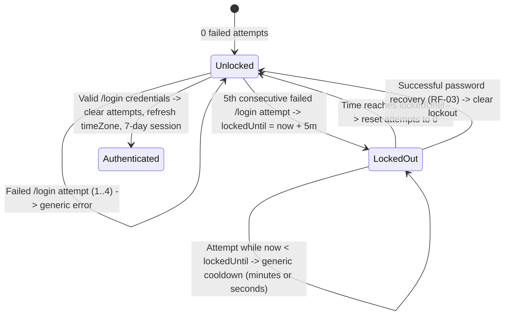

# Spec 004: User Accounts, Authentication, Profile & Recovery

- **Feature Name:** `004-auth`
- **Status:** implemented
- **Created Date:** 2026-11-15
- **Authors:** SDD Planner Agent
- **SRS / SVD References:** `RF-01`, `RF-02`, `RF-03`, `RF-04`, `RF-05`, `RF-06`, `UI-01`, `UI-06`, `UI-07`, `RNF-01`, `RNF-05`, `RNF-06`, `RNF-07`, `RNF-09`, `RNF-10`, `RNF-12`, `RNF-14`, `RNF-18`, `RNF-19`, `RNF-20`, `Appendix A`, `Appendix B`, `Appendix D`, `Constitution Principles 1–6`

---

## 1. Purpose & Background

### 1.1 Purpose
Define the functional requirements, security boundaries, validation constraints, session lifecycle, route protection rules, user preferences, and Spanish localization contracts for User Accounts and Access in Task by Task. This specification implements SRS requirements `RF-01` (User registration), `RF-02` (Login and logout), `RF-03` (Password recovery with recovery codes), `RF-04` (Profile and preferences), and `RF-05` (Account deletion), together with Personal group creation on registration (`RF-06`), destructive confirmations (`UI-06`), time format propagation (`UI-07`), and non-functional requirements (`RNF-01`, `RNF-05`, `RNF-06`, `RNF-07`, `RNF-09`, `RNF-10`, `RNF-12`, `RNF-14`, `RNF-18`, `RNF-19`, `RNF-20`).

### 1.2 Background
Until now, Task by Task operated in an unauthenticated single-workspace mode seeded with an anonymous `"Personal"` placeholder group. To transition to a true multi-account MVP aligned with the SRS:
1. Users must register accounts with a unique email and username, receive a clean, dedicated `"Personal"` group (`RF-01`, `RF-06`), and receive **8 single-use recovery codes shown once** for password recovery without email.
2. Passwords must never be stored in plaintext; accounts store only non-reversible salted cryptographic password hashes (`RNF-05`).
3. Login must validate credentials safely (returning generic error messages that never disclose whether an email exists), enforce consecutive failed-attempt throttling (`RNF-06`), maintain sessions for up to 7 days (`RF-02`, `RNF-09`), and refresh the user's browser timezone on login (`RF-02`).
4. Protected application views (`/`, `/profile`) must require a valid session and isolate groups, tasks, tags, recovery codes, and notifications strictly to the authenticated user—starting every newly registered account with a fresh workspace without adopting pre-existing anonymous placeholder data.
5. Users must be able to manage their profile, change their password (requiring current password), switch time format between `24h` (default) and `12h` for both display and capture (`RF-04`, `UI-07`), regenerate recovery codes (requiring current password and invalidating old ones), and permanently delete their account and all owned data (`RF-05`, `RNF-10`).

---

## 2. Scope

### 2.1 In Scope
1. **User Registration (`RF-01`, `RF-06`, `RNF-05`, `RNF-19`, `Appendix B`):**
   - Account creation form (`/register`) accepting `email` (valid format, max 254 chars, unique case-insensitively), `username` (3..30 alphanumeric chars `[A-Za-z0-9]`, unique case-insensitively), `displayName` (2..50 chars), and `password` (6..30 chars, preserved untrimmed).
   - Non-reversible password hashing (`passwordHash`, never storing plaintext passwords).
   - Automatic capture of browser IANA timezone (defaulting to `'UTC'` if unavailable) and initialization of `timeFormat` to `'24h'`.
   - Automatic provisioning of a clean, user-owned `"Personal"` group (`isPersonal: true`, `type: 'individual'`, unique identifier, creator membership) with zero adoption of pre-existing anonymous placeholder data.
   - Generation of 8 unique single-use 8-character uppercase alphanumeric recovery codes persisted for the new user.
   - Immediate session creation and ephemeral one-time presentation of the 8 recovery codes with an explicit instruction to save them before continuing into the main workspace (`/`).
2. **Authentication, Session Lifecycle & Lockout (`RF-02`, `RNF-06`, `RNF-09`, `RNF-18`):**
   - Sign-in form (`/login`) accepting email and non-empty password.
   - Generic authentication failure message that never reveals whether an email address is registered.
   - Consecutive failed login attempt throttling (`RNF-06`): 5 consecutive failed attempts per normalized email on `/login` trigger a 5-minute temporary lockout (persisted across page reloads), cleared upon successful login or successful password recovery.
   - Session persistence valid for 7 days from login/registration; automatic session validation on startup, route transitions, and before authenticated operations (clearing expired or orphaned sessions and redirecting to `/login`, displaying an expiration notice only when an existing session exceeded its 7-day limit, `RNF-18`).
   - Automatic browser timezone refresh on successful login (`RF-02`).
   - Explicit logout action ("Cerrar sesión") from the authenticated workspace, clearing the active session, resetting user-scoped in-memory state, signaling cessation of device notifications for the signed-out session (`RF-02`), and redirecting to `/login`.
3. **Password Recovery via Single-Use Codes (`RF-03`, `RNF-05`, `RNF-06`, `RNF-19`):**
   - Recovery form (`/recover`) accepting account email, an 8-character alphanumeric recovery code, and a new password (6..30 chars, untrimmed).
   - Validation and single-use consumption of the recovery code (`used: true`, `usedAt` recorded), password hash update, and clearance of any login lockout for that email.
   - Generic error feedback when email or code is invalid or already used, without revealing email existence.
   - Informative Spanish notice explaining that if all recovery codes are lost or exhausted, account access cannot be recovered in the MVP (`Appendix D`).
4. **Profile, Preferences & Recovery Code Regeneration (`RF-04`, `UI-07`, `RNF-09`, `RNF-14`):**
   - Authenticated profile view (`/profile`) accessible from the main workspace header, allowing editing of `displayName`, `username`, `email`, and `timeFormat` (`'24h'` or `'12h'`), plus read-only display of the detected `timeZone`.
   - Password change section requiring the **current password** and a valid new password (6..30 chars, untrimmed).
   - Recovery code regeneration section requiring the **current password**, invalidating all previous recovery codes, generating 8 fresh single-use codes, and displaying them **once only** in transient view state with the save warning.
   - Propagation of `timeFormat` (`24h` vs. `12h`) and `timeZone` across both task time visualization (task cards) and task due-time capture (task creation/editing forms, including `12h <-> 24h` conversion and unset/partial-time validation) (`RF-04`, `UI-07`).
5. **Account Deletion (`RF-05`, `UI-06`, `RNF-10`):**
   - Account deletion trigger on `/profile` opening a destructive confirmation dialog (`UI-06`) warning that the user's account, groups, tasks, tags, recovery codes, and notifications will be permanently deleted.
   - Current password verification required to confirm deletion.
   - Strict per-user cascade deletion: removes only the authenticated user's profile, owned groups, tasks in those groups, tags in those groups, recovery codes, notifications, login lockout state, and active session, preserving all other local user accounts untouched.
6. **Route Guarding & Per-User Data Isolation (`RF-01`, `RF-02`, `RF-06`, `RNF-18`, `RNF-20`):**
   - Protected routes: `/` (Groups Grid View) and `/profile` (Profile & Preferences).
   - Public auth routes: `/login`, `/register`, `/recover`.
   - Unauthenticated access to protected routes or unrecognized routes redirects to `/login`; authenticated access to public auth routes redirects to `/` (except while actively remaining in the uninterrupted in-memory post-registration one-time recovery codes step on `/register`).
   - Workspace data isolation: loads and mutates only groups belonging to the authenticated user (`creatorId === currentUser.id` or `currentUser.id` in `members` per `RNF-20`), along with their tasks and tags, and self-heals if an authenticated user lacks an accessible `"Personal"` group (`RNF-18`).
7. **Accessibility, Mobile-First Layout & Spanish Localization (`UI-01`, `RNF-12`, `RNF-14`):**
   - Responsive Mobile-First layouts (~375px to desktop), keyboard navigation, visible focus rings, descriptive Spanish `aria-label`s, accessible error alerts, and 100% centralized Spanish copy.

### 2.2 Out of Scope
- Email verification on signup, email-based invitations, and email-based password recovery (`RF-11`, classified as **Posterior** in the SRS; documented limitation in `Appendix D`).
- Shared groups, member roles, invitations, and collaborator notifications on group/account deletion (`RF-05` Posterior clause, `RF-08`, `RF-09`, `RF-10`, `RF-30`).
- Analyst role login and global metrics dashboard (`RF-31`, `RF-32`, classified as **Posterior** in the SRS).
- Notification center UI and browser notification scheduling (`RF-27`, `RF-28`, `RF-29`, planned in `005-notifications`); `004-auth` preserves the storage isolation boundary for notification cascade deletion on account deletion (`RF-05`) and exposes clean session-end/logout lifecycle hooks so `005-notifications` can stop sending browser notifications on that device upon logout or session termination (`RF-02`).
- OAuth / social login or third-party identity providers.

### 2.3 Cross-Spec Supersession & Integration Boundaries
This specification supersedes and refines standalone unauthenticated assumptions from earlier MVP specs:
1. **Supersedes Anonymous Seed Provisioning (`001-tasks` `REQ-TK-30`, `002-groups` `REQ-GRP-01`):** Startup creation of an anonymous `'local-user'` `"Personal"` group is replaced by per-user `"Personal"` group provisioning at account registration (`REQ-AU-03(4)`) and authenticated missing-Personal self-healing (`REQ-AU-21`). Pre-existing `'local-user'` data in storage is never exposed or adopted into any registered user's workspace.
2. **Refines Workspace Hydration (`002-groups` `REQ-GRP-16`, `REQ-GRP-16b`):** Workspace initialization and manual refresh load and mutate strictly the authenticated user's accessible groups, tasks, and tags rather than all records in global storage.
3. **Refines Due-Time Capture & Format Propagation (`001-tasks` `REQ-TK-01`, `REQ-TK-04`, `REQ-TK-29`):** Extends task due-time capture (`REQ-TK-01`, `REQ-TK-04`) to adapt between `24h` and `12h` input modes per the authenticated user's `timeFormat` preference (`REQ-AU-16`).

---

## 3. Requirements (EARS Format)

### 3.1 User Registration & One-Time Recovery Codes (`RF-01`, `RF-06`, `RNF-05`, `RNF-19`, `Appendix B`)

- **REQ-AU-01 (Event-Driven - Registration Input & Field Validation):**  
  When a user submits the registration form (`/register`), the system shall validate:
  1. `email`: trimmed, case-normalized to lowercase, non-empty, valid email format, maximum 254 characters (`Appendix B`).
  2. `username`: trimmed, 3 to 30 characters, strictly ASCII letters and digits (`[A-Za-z0-9]`).
  3. `displayName`: trimmed, 2 to 50 characters.
  4. `password`: 6 to 30 characters (`Appendix B`, preserved without trimming or silent modification).  
  If any field fails format or length validation, the system shall reject registration, keep the form open, and display the corresponding localized Spanish field error (`RNF-07`, `RNF-19`).

- **REQ-AU-02 (Unwanted Behavior - Duplicate Email or Username):**  
  If the submitted `email` or `username` matches an existing registered user case-insensitively, then the system shall reject registration and display `auth.emailAlreadyExists` or `auth.usernameAlreadyExists` on the conflicting field without creating any account, group, or recovery codes (`RF-01`).

- **REQ-AU-03 (Event-Driven - Account Provisioning, Hashing & Personal Group Creation):**  
  When a valid, unique registration payload is submitted, the system shall:
  1. Generate a unique user identifier (`id`), persist `email` trimmed and lowercased, persist `username` and `displayName` trimmed preserving letter case, and record `createdAt` as the current ISO-8601 UTC timestamp.
  2. Derive and store a salted non-reversible cryptographic `passwordHash`; plaintext passwords shall never be persisted (`RNF-05`).
  3. Detect and store the user's current browser IANA timezone (defaulting to `'UTC'` if unavailable) and initialize `timeFormat` to `'24h'` (`RF-01`).
  4. Create a clean default `"Personal"` group owned solely by the new user (`id`: unique identifier, `name: 'Personal'`, `creatorId: user.id`, `isPersonal: true`, `type: 'individual'`, `members: [{ userId: user.id, role: 'creator', joinedAt: createdAt }]`, `createdAt`) without adopting or merging any pre-existing anonymous `'local-user'` placeholder data (`RF-01`, `RF-06`, `RNF-20`).
  5. Generate and persist exactly 8 unique, single-use 8-character uppercase alphanumeric (`[A-Z0-9]{8}`) recovery codes linked to `user.id` with `used: false` (`RF-01`, `Appendix B`).
  6. Establish and persist an authenticated 7-day session for the new user (`RF-01`, `RNF-09`).

- **REQ-AU-04 (Event-Driven - Ephemeral One-Time Recovery Codes Display on Registration):**  
  When registration succeeds, the system shall hold the 8 generated plaintext recovery codes strictly in transient in-memory view state on `/register` and display them **once only** together with an explicit Spanish warning (`auth.recoveryCodesWarning`) and a confirmation action (`auth.continueToApp`). Clicking `"He guardado mis códigos, continuar"` clears the transient codes and navigates to `/`. Navigating away to any other route (`/`, `/profile`, `/login`, `/recover`, `*`) or reloading the page immediately clears the transient plaintext codes and transitions the user into normal authenticated routing (`REQ-AU-20(2)`), so revisiting or reloading `/register` redirects to `/` and never reveals those codes again (`RF-01`).

### 3.2 Sign-In, Logout, Session Lifecycle & Lockout (`RF-02`, `RNF-06`, `RNF-09`, `RNF-18`)

- **REQ-AU-05 (Event-Driven - Sign-In Input Validation & Generic Credential Rejection):**  
  When a user submits the login form (`/login`):
  1. The system shall first validate `email` (trimmed, lowercased, non-empty, valid email format, <= 254 characters) and `password` (non-empty `length >= 1`, preserved without trimming or silent modification, without enforcing creation-time `6..30` length limits). If format or presence validation fails, the system shall reject submission locally with field-level Spanish errors (`auth.emailRequired`, email format/length error, or `auth.passwordRequiredOnLogin`) and shall **not** evaluate credentials or increment `failedAttempts` (`REQ-AU-06`).
  2. When input validation succeeds and the normalized email is not currently locked out (`REQ-AU-06`), the system shall verify whether a registered account exists for that normalized email and whether the password matches the stored `passwordHash`.
  3. If no matching user exists or password verification fails, the system shall record a failed attempt for that normalized email and display the generic Spanish authentication error (`auth.invalidCredentials`) without revealing whether the email address is registered (`RF-02`).

- **REQ-AU-06 (State-Driven & Unwanted Behavior - Consecutive Failed Login Lockout):**  
  The system shall persist consecutive failed `/login` attempts and lockout state per normalized email across page reloads (`RNF-06`, `RF-02`):
  1. Failed `/login` attempts 1 through 4 increment the consecutive failure count for that normalized email and show `auth.invalidCredentials`.
  2. On the 5th consecutive failed `/login` attempt for that normalized email, the system shall lock login attempts for that email for **5 minutes** (`lockedUntil = now + 5 minutes`) and display a generic Spanish cooldown message without revealing account existence: when `remainingMs >= 60_000`, display `auth.tooManyAttemptsMinutes` with `{minutes} = Math.ceil(remainingMs / 60_000)`; when `0 < remainingMs < 60_000`, display `auth.tooManyAttemptsSeconds` with `{seconds} = Math.max(1, Math.ceil(remainingMs / 1000))`.
  3. While `now < lockedUntil`, any subsequent `/login` attempt for that email shall be rejected immediately with the generic cooldown message above without verifying credentials or disclosing account existence.
  4. Once `now >= lockedUntil`, the expired attempt counter shall reset to 0 before evaluating the next login attempt.
  5. Upon a successful login (`REQ-AU-07`) or a successful password recovery (`REQ-AU-11`), the system shall clear the failed-attempt count and lockout state for that email.
  6. Failed-attempt throttling applies strictly to `/login` attempts; invalid `currentPassword` checks on authenticated `/profile` actions (`REQ-AU-14`, `REQ-AU-15`, `REQ-AU-18`) do not increment `/login` lockout counters or terminate the active session.

- **REQ-AU-07 (Event-Driven - Successful Sign-In & Timezone Refresh):**  
  When login credentials succeed for an unlocked account, the system shall:
  1. Refresh the user's stored `timeZone` from the current browser timezone (`RF-02`).
  2. Clear any failed login attempts and lockout state for that email.
  3. Create and persist a new active session with a unique `token`, `createdAt`, and `expiresAt` set to **7 days** from creation (`RF-02`, `RNF-09`, `Appendix B`).
  4. Redirect the user to the main workspace (`/`).

- **REQ-AU-08 (Event-Driven - Logout):**  
  When an authenticated user activates `"Cerrar sesión"`, the system shall remove the active session from persistent storage, clear user-scoped in-memory state (groups, tasks, tags, and any transient recovery-code view state), emit a session-end signal so device browser notification scheduling stops for that signed-out session (`RF-02`), and redirect cleanly to `/login` without displaying `auth.sessionExpired` (`RF-02`, `RNF-09`).

- **REQ-AU-09 (State-Driven - Session Validation, Mid-Session Expiry & Orphan Handling):**  
  On application startup, on every route transition, and immediately prior to executing any authenticated profile or workspace mutation or manual refresh (saving profile, changing password, regenerating recovery codes, confirming account deletion, or mutating/refreshing groups, tasks, and tags), the system shall validate the persisted session (`RNF-18`):
  1. If no persisted session exists, the system shall clear any stale in-memory user state and enforce unauthenticated routing (`REQ-AU-20(1)`) without displaying `auth.sessionExpired`.
  2. If a persisted session exists and `now >= session.expiresAt` (7-day limit exceeded), the system shall abort any pending mutation without persisting partial changes, remove the expired session, clear user-scoped in-memory state, signal session teardown (`RF-02`), and redirect to `/login` with an expiration notice displaying `auth.sessionExpired`.
  3. If a persisted session exists and `session.userId` does not match an existing `User` record (orphaned session), the system shall abort any pending mutation cleanly, remove the orphaned session, clear user-scoped in-memory state, signal session teardown, and redirect cleanly to `/login` without falsely displaying `auth.sessionExpired` (`RNF-18`).

### 3.3 Password Recovery via Recovery Codes (`RF-03`, `RNF-05`, `RNF-06`, `RNF-19`)

- **REQ-AU-10 (Event-Driven - Password Recovery Input Validation):**  
  When a user submits the password recovery form (`/recover`), the system shall validate:
  1. `email`: trimmed, lowercased, non-empty, valid email format, maximum 254 characters (`Appendix B`).
  2. `recoveryCode`: trimmed, non-empty (`auth.recoveryCodeRequired`), exact length 8 (`auth.recoveryCodeLengthError`, `Appendix B`), strictly ASCII alphanumeric `[A-Za-z0-9]{8}` (`auth.recoveryCodeFormatError`).
  3. `newPassword`: 6 to 30 characters (`Appendix B`, preserved without trimming or silent modification).  
  Invalid inputs shall keep the form open and display the corresponding localized Spanish validation errors (`RNF-07`, `RNF-19`).

- **REQ-AU-11 (Event-Driven - Single-Use Code Verification & Password Reset):**  
  When a validly formatted recovery request is submitted:
  1. The system shall look up the user by normalized email and check for an unused (`used === false`) recovery code belonging to that user matching the trimmed, uppercase-normalized 8-character code.
  2. If no user exists or no matching unused code exists for that user, the system shall reject the request with `auth.invalidRecoveryRequest` without revealing email existence.
  3. If a matching unused code exists, the system shall mark that code as consumed (`used: true`, `usedAt: current ISO-8601 UTC timestamp`), update the user's `passwordHash` with the salted non-reversible hash of `newPassword` (`RNF-05`; reusing the account's current password is permitted), clear any login lockout/failed-attempt state for that email, notify the user with `auth.recoverSuccess`, and direct the user to sign in on `/login` (`RF-03`).

- **REQ-AU-12 (Ubiquitous - Exhausted or Lost Codes Limitation Disclosure):**  
  On the password recovery view (`/recover`), the system shall display `auth.recoverLimitationNote` explaining clearly that each recovery code can be used only once and that if all codes are lost or exhausted, account recovery is not available (`Appendix D`).

### 3.4 Profile, Preferences & Recovery Code Regeneration (`RF-04`, `UI-07`, `RNF-09`, `RNF-14`, `RNF-19`)

- **REQ-AU-13 (Event-Driven - Profile Information & Time Format Update):**  
  When an authenticated user accesses `/profile`, the system shall pre-fill their current `displayName`, `username`, `email`, and `timeFormat` (`'24h'` or `'12h'`), and display their active `timeZone` as read-only information (`RF-04`). When the user saves changes (after verifying an active valid session per `REQ-AU-09`):
  1. `displayName` (trimmed, 2..50 chars), `username` (trimmed, 3..30 `[A-Za-z0-9]` chars), and `email` (trimmed, lowercased, non-empty, valid format, <= 254 chars) shall be validated against `Appendix B` rules.
  2. Case-insensitive uniqueness checks for `email` and `username` shall exclude the current user's own `id` (allowing case-only updates to `username` or retaining the current `email`, while rejecting collisions with any other account using `auth.emailAlreadyExists` or `auth.usernameAlreadyExists`).
  3. If the user's normalized `email` changes, any persisted `LoginLockoutState` keyed to the previous normalized `email` shall be removed (while any independent lockout state on the new normalized `email` remains untouched).
  4. The updated `User` record (including `timeFormat`) shall persist immediately and update the active authenticated user state (`RF-04`, `UI-07`).

- **REQ-AU-14 (Event-Driven - Password Change Requiring Current Password):**  
  When an authenticated user submits a password change on `/profile`:
  1. After validating active session integrity (`REQ-AU-09`), the system shall first validate that `currentPassword` is non-empty (`length >= 1`, preserved without trimming; empty rejects with `auth.currentPasswordRequired`) and `newPassword` is 6..30 characters (preserved without trimming; reusing the current password is permitted).
  2. The system shall then verify `currentPassword` against the stored `passwordHash`. If verification fails, the system shall reject the change with `auth.invalidCurrentPassword` and leave the existing password, active session, and `/login` lockout counters untouched.
  3. If verification succeeds, the system shall persist the new salted non-reversible `passwordHash`, rotate the active session `token` while retaining the active user's `userId` and original `expiresAt` (keeping the user signed in on `/profile`), clear the password fields, and display `auth.passwordChanged` (`RF-04`, `RNF-05`, `RNF-09`).

- **REQ-AU-15 (Event-Driven - Recovery Codes Regeneration Requiring Current Password):**  
  When an authenticated user requests recovery code regeneration on `/profile` (`RF-04`, `RNF-09`):
  1. After validating active session integrity (`REQ-AU-09`), the system shall first validate that `currentPassword` is non-empty (`length >= 1`, preserved without trimming; empty rejects with `auth.currentPasswordRequired`).
  2. The system shall verify `currentPassword` against `passwordHash`. If verification fails, the system shall reject the request with `auth.invalidCurrentPassword` (without incrementing `/login` lockout counters) and leave existing recovery codes untouched.
  3. If `currentPassword` matches `passwordHash`, the system shall invalidate/remove all previous recovery codes for that user, generate and persist 8 new single-use `[A-Z0-9]{8}` recovery codes, clear the `currentPassword` field, and display the 8 new codes **once only** in transient in-memory view state with the explicit save warning (`auth.regeneratedCodesTitle` + `auth.recoveryCodesWarning`). Once dismissed, navigated away from, or reloaded, those newly generated codes shall no longer be retrievable in plaintext from `/profile` (`RF-01`, `RF-04`).

- **REQ-AU-16 (State-Driven - Time Format Propagation for Display and Capture):**  
  While an authenticated user has `timeFormat` configured (`'24h'` default or `'12h'`):
  1. All task due times rendered on task cards and workspace views shall format times strictly according to the active user's `timeFormat` and `timeZone` (`UI-07`, `RNF-14`).
  2. In task creation and editing forms, due-time capture shall adapt to the active user's `timeFormat` (`RF-04`, `UI-07`):
     - **24-Hour Mode (`'24h'`):** Captures canonical 24-hour time (`HH:mm`).
     - **12-Hour Mode (`'12h'`):** Provides explicit 12-hour selection controls (12-hour `01..12` + unset option, minutes `00..59` + unset option, and period `a. m.` / `p. m.` + unset option):
       - **Unset state:** When all three controls are unset, `dueTime` evaluates to `null`.
       - **Complete state:** When all three controls are selected, `dueTime` converts bijectively to canonical 24-hour `HH:mm` using: `12:mm a. m. <-> 00:mm`, `01:mm..11:mm a. m. <-> 01:mm..11:mm`, `12:mm p. m. <-> 12:mm`, and `01:mm..11:mm p. m. <-> 13:mm..23:mm` (used both when loading an existing task for editing and when persisting submission).
       - **Partial selection (`REQ-AU-16` error):** If one or two controls are selected while at least one remains unset, form submission shall be rejected with `auth.incompleteTimeError`, keeping the form open.
     - **`dueDate` Dependency & Clear Action (`REQ-TK-04`):** Whenever `dueDate` is empty, all due-time capture controls (in both `'24h'` and `'12h'` modes) and `"Limpiar hora"` (`auth.clearTimeLabel`) shall be disabled, and clearing `dueDate` automatically resets all time capture state to unset (`null`). When `dueDate` is present and any time part or time value is selected, `"Limpiar hora"` resets due time back to unset (`null`); when time is already completely unset, `"Limpiar hora"` is disabled.

### 3.5 Account Deletion (`RF-05`, `UI-06`, `RNF-10`)

- **REQ-AU-17 (Event-Driven - Account Deletion Confirmation Prompt):**  
  When an authenticated user activates `"Eliminar mi cuenta"` on `/profile`, the system shall display a destructive confirmation dialog (`UI-06`) explicitly warning that the action is permanent and will permanently delete the user's account along with all of their groups, tasks, tags, recovery codes, and notifications, and requiring the user to enter their **current password** to confirm (`RF-05`).

- **REQ-AU-18 (Unwanted Behavior - Missing or Invalid Password on Account Deletion):**  
  If the user attempts to confirm account deletion with an empty `currentPassword` (`length === 0`, checked without trimming), the system shall reject deletion with `auth.currentPasswordRequired`; if `currentPassword` (preserved without trimming) does not match the stored `passwordHash`, the system shall reject deletion with `auth.invalidCurrentPassword` (without incrementing `/login` lockout counters). In both cases, the confirmation dialog stays open and the user's account and data remain preserved (`RF-05`, `RNF-07`).

- **REQ-AU-19 (Event-Driven - Per-User Cascade Account Deletion):**  
  After validating active session integrity (`REQ-AU-09`) and verifying the user's current password (`REQ-AU-18`), the system shall:
  1. Identify all groups owned by `user.id` (`creatorId === user.id`).
  2. Permanently delete all tasks belonging to those groups, all tags belonging to those groups, and all those groups (including the user's `"Personal"` group).
  3. Permanently delete all recovery codes belonging to `user.id`, all notifications belonging to `user.id`, the `User` record itself (`RNF-10`), any `LoginLockoutState` for the user's normalized email, and the active `Session`.
  4. Strictly preserve all data belonging to any other registered user accounts in persistent storage.
  5. Clear user-scoped in-memory state, signal session teardown (`RF-02`), and redirect cleanly to `/login` displaying `auth.accountDeleted` (without displaying `auth.sessionExpired`) (`RF-05`, `RNF-10`).

### 3.6 Route Guarding & Multi-Account Workspace Isolation (`RF-01`, `RF-02`, `RF-06`, `RNF-18`, `RNF-20`)

- **REQ-AU-20 (State-Driven - Route Guarding):**  
  The system shall enforce client-side route access guards consistent with Section 4.2:
  1. While unauthenticated (no valid active session), accessing `/`, `/profile`, or any unrecognized route shall redirect to `/login`.
  2. While authenticated with a valid active session, accessing `/login` or `/recover` shall redirect to `/`, clearing any transient post-registration one-time recovery codes view; accessing `/register` shall render the one-time recovery codes step **only** while the uninterrupted transient post-registration view state is active (`REQ-AU-04`), and shall redirect to `/` on page reload or subsequent visits once left. Direct navigation from the one-time recovery codes view to `/` or `/profile` is permitted and immediately discards the transient recovery codes view.
  3. While authenticated, navigating to any unrecognized route shall clear any transient one-time recovery codes view and redirect safely to `/` (`RNF-18`).

- **REQ-AU-21 (Ubiquitous - Authenticated Workspace Data Isolation & Missing Personal Self-Healing):**  
  While authenticated in the workspace (`/`), the system shall load, display, create, update, move, copy, and delete **only** groups owned by or containing the authenticated user (`group.creatorId === currentUser.id` or `currentUser.id` present in `group.members` per `RNF-20`), along with tasks and tags belonging to those groups. Creating a new individual group in the workspace shall set `creatorId` and the single creator member `userId` to `currentUser.id`. Pre-existing anonymous `'local-user'` placeholder records (`001-tasks` `REQ-TK-30`) shall never be exposed or adopted into any registered user's workspace. If during authenticated workspace hydration the user has no accessible `"Personal"` group (`isPersonal === true`), the system shall self-heal gracefully by provisioning a fresh user-owned `"Personal"` group (`creatorId: currentUser.id`, `isPersonal: true`, `type: 'individual'`) without throwing an unhandled error and without touching `'local-user'` or other users' records (`RF-06`, `RNF-18`, `RNF-20`).

### 3.7 Accessibility, Mobile-First Responsiveness & Spanish Localization (`UI-01`, `RNF-12`, `RNF-14`)

- **REQ-AU-22 (Ubiquitous - Responsive Mobile-First Auth & Profile Views):**  
  All authentication views (`/login`, `/register`, `/recover`), the profile view (`/profile`), the workspace account navigation bar, and all confirmation dialogs (one-time recovery codes and account deletion) shall render cleanly on mobile (~375px), tablet, and desktop viewports (`UI-01`).

- **REQ-AU-23 (Ubiquitous - Keyboard Accessibility, Focus & Spanish Copy):**  
  All auth inputs, password visibility or action buttons, navigation links, time-format controls, recovery-code copy/continue controls, and destructive modals shall be keyboard-navigable (`Tab`, `Enter`, `Space`, `Escape`), display visible focus indicators, label every form control explicitly, announce errors accessibly, and source 100% of user-facing strings from the centralized Spanish localization dictionary (`RNF-12`, `RNF-14`).

---

## 4. Domain Models & Specifications

### 4.1 Auth Entities & Security Invariants

```
User Contract (Appendix B):
- id: string (unique identifier)
- email: string (trimmed, lowercased, valid email format, <= 254 chars, unique case-insensitively)
- username: string (trimmed, 3..30 chars, ^[A-Za-z0-9]+$, unique case-insensitively)
- displayName: string (trimmed, 2..50 chars)
- passwordHash: string (salted non-reversible cryptographic hash; raw password NEVER persisted)
- timeZone: string (IANA timezone identifier, refreshed on login)
- timeFormat: '24h' | '12h' (default '24h')
- createdAt: ISO-8601 UTC timestamp

RecoveryCode Contract (Appendix B):
- id: string (unique identifier)
- userId: string (owner User.id)
- code: string (exact length 8 uppercase ASCII alphanumeric [A-Z0-9]{8})
- used: boolean (false on generation, true once consumed)
- usedAt: ISO-8601 UTC timestamp | null (set when consumed)

Session Contract (Appendix B):
- userId: string (authenticated User.id)
- token: string (unique session token, rotated on password change preserving expiresAt)
- createdAt: ISO-8601 UTC timestamp
- expiresAt: ISO-8601 UTC timestamp (createdAt + 7 days)

LoginLockoutState Contract (RNF-06):
- normalizedEmail: string (keyed by email.trim().toLowerCase())
- failedAttempts: number (0..5)
- lockedUntil: ISO-8601 UTC timestamp | null (set to now + 5 minutes on 5th consecutive /login failure)

Core Invariants:
1. Non-Reversible Credentials: Plaintext passwords never exist in persistent storage or user state; password inputs remain untrimmed across all auth and security forms.
2. Anti-Enumeration: Login failures, login lockouts, and recovery failures never disclose whether an email address is registered; invalid login format does not increment failure counters.
3. Single-Use Recovery Codes: Plaintext recovery codes exist only in transient UI state immediately after registration or regeneration; reloading or leaving the view discards them, a code with used === true can never be reused, and regenerating codes invalidates all prior codes for that user.
4. Clean Per-User Workspace: Every registered user gets a unique Personal group (isPersonal: true, creatorId: user.id) and sees zero data from other accounts or legacy 'local-user' placeholders.
5. Session Integrity & Lockout Scope: Login lockout applies strictly to /login; authenticated /profile currentPassword checks never alter /login lockout counters. Expired sessions block pending mutations and display the expiration notice, whereas explicit logout, orphaned sessions, and account deletion do not.
```

### 4.2 Route Access & Navigation Matrix (`REQ-AU-20`)

| Route | Unauthenticated User | Authenticated User (Normal) | Authenticated User (Just Registered, Viewing Codes) |
| :--- | :--- | :--- | :--- |
| `/login` | Render Login View | Redirect to `/` | Exit one-time codes view and redirect to `/` |
| `/register` | Render Register View | Redirect to `/` | Render One-Time Recovery Codes Confirmation (on reload: exit one-time view and redirect to `/`) |
| `/recover` | Render Recovery View | Redirect to `/` | Exit one-time codes view and redirect to `/` |
| `/` | Redirect to `/login` | Render Groups Grid View (User-Scoped) | Exit one-time codes view and render Groups Grid View (User-Scoped) |
| `/profile` | Redirect to `/login` | Render Profile & Preferences View | Exit one-time codes view and render Profile & Preferences View |
| `*` (Unknown) | Redirect to `/login` | Redirect to `/` | Exit one-time codes view and redirect to `/` |

### 4.3 Lockout & Recovery State Transitions (`RF-02`, `RF-03`, `RNF-06`)



### 4.4 Spanish Localization Contract (`RNF-14`)

All user-facing copy for authentication, recovery, profile, time-format capture, and account deletion is centralized in the Spanish localization dictionary under an `auth` namespace (integrating with shared `validation`, `common`, and `tasks` keys where applicable):

- **Navigation & Workspace Header:**
  - `profileLink`: `'Mi perfil'`
  - `logoutButton`: `'Cerrar sesión'`
  - `backToWorkspace`: `'Volver a mis grupos'`
  - `greetingPrefix`: `'Hola,'`
- **Login (`/login`):**
  - `loginTitle`: `'Iniciar sesión'`
  - `loginSubtitle`: `'Accede a tus grupos y tareas'`
  - `emailLabel`: `'Correo electrónico'`
  - `emailPlaceholder`: `'tu@correo.com'`
  - `emailRequired`: `'El correo electrónico es obligatorio.'`
  - `passwordLabel`: `'Contraseña'`
  - `passwordPlaceholder`: `'Ingresa tu contraseña'`
  - `passwordRequiredOnLogin`: `'Ingresa tu contraseña.'`
  - `loginButton`: `'Entrar'`
  - `invalidCredentials`: `'Correo electrónico o contraseña incorrectos.'`
  - `tooManyAttemptsMinutes`: `'Demasiados intentos fallidos. Espera {minutes} min antes de intentar de nuevo.'`
  - `tooManyAttemptsSeconds`: `'Demasiados intentos fallidos. Espera {seconds} s antes de intentar de nuevo.'`
  - `sessionExpired`: `'Tu sesión ha expirado. Inicia sesión nuevamente.'` (displayed exclusively after redirect caused by an expired 7-day session per `REQ-AU-09(2)`)
  - `goToRegister`: `'¿No tienes cuenta? Regístrate'`
  - `goToRecover`: `'¿Olvidaste tu contraseña?'`
- **Registration (`/register`), Profile Uniqueness (`/profile`) & One-Time Recovery Codes (`RF-01`, `RF-04`):**
  - `registerTitle`: `'Crear cuenta'`
  - `registerSubtitle`: `'Comienza a organizar tus tareas por grupos'`
  - `usernameLabel`: `'Nombre de usuario'`
  - `usernamePlaceholder`: `'Ej. usuario123 (solo letras y números)'`
  - `displayNameLabel`: `'Nombre para mostrar'`
  - `displayNamePlaceholder`: `'Ej. Ana García'`
  - `registerButton`: `'Registrarse'`
  - `goToLogin`: `'¿Ya tienes cuenta? Inicia sesión'`
  - `emailAlreadyExists`: `'Ya existe un registro con este correo electrónico'` (used by both `/register` and `/profile`)
  - `usernameAlreadyExists`: `'Ya existe un registro con este nombre de usuario'` (used by both `/register` and `/profile`)
  - `recoveryCodesTitle`: `'Guarda tus códigos de recuperación'`
  - `recoveryCodesWarning`: `'Estos 8 códigos se muestran una sola vez y son de un solo uso. Guárdalos en un lugar seguro; si los pierdes y olvidas tu contraseña, no podrás recuperar el acceso a tu cuenta.'`
  - `copyRecoveryCodes`: `'Copiar códigos'`
  - `copiedRecoveryCodes`: `'Códigos copiados'`
  - `continueToApp`: `'He guardado mis códigos, continuar'`
- **Password Recovery (`/recover`, `RF-03`):**
  - `recoverTitle`: `'Recuperar contraseña'`
  - `recoverSubtitle`: `'Usa uno de tus códigos de recuperación de un solo uso'`
  - `recoveryCodeLabel`: `'Código de recuperación'`
  - `recoveryCodePlaceholder`: `'Código de 8 caracteres'`
  - `recoveryCodeRequired`: `'Ingresa un código de recuperación.'`
  - `recoveryCodeLengthError`: `'El código de recuperación debe tener exactamente 8 caracteres.'`
  - `recoveryCodeFormatError`: `'El código de recuperación solo puede contener letras y números.'`
  - `newPasswordLabel`: `'Nueva contraseña'`
  - `recoverButton`: `'Restablecer contraseña'`
  - `invalidRecoveryRequest`: `'El correo o el código de recuperación no es válido o ya fue utilizado.'`
  - `recoverSuccess`: `'Tu contraseña ha sido restablecida. Ya puedes iniciar sesión.'`
  - `recoverLimitationNote`: `'Cada código es de un solo uso. Si agotaste o perdiste todos tus códigos, no es posible recuperar la cuenta en esta versión.'`
- **Profile, Preferences & Security Actions (`/profile`, `RF-04`, `RF-05`, `UI-07`):**
  - `profileTitle`: `'Perfil y preferencias'`
  - `profileSectionTitle`: `'Datos de la cuenta'`
  - `timeFormatLabel`: `'Formato de hora'`
  - `timeFormat24h`: `'24 horas (ej. 14:30)'`
  - `timeFormat12h`: `'12 horas (ej. 02:30 p. m.)'`
  - `timeZoneLabel`: `'Zona horaria detectada'`
  - `timeZoneHint`: `'Se actualiza automáticamente al iniciar sesión.'`
  - `saveProfileButton`: `'Guardar cambios'`
  - `profileSaved`: `'Perfil y preferencias actualizados.'`
  - `passwordSectionTitle`: `'Cambiar contraseña'`
  - `currentPasswordLabel`: `'Contraseña actual'`
  - `currentPasswordRequired`: `'Ingresa tu contraseña actual.'` (used by password change `REQ-AU-14`, recovery code regeneration `REQ-AU-15`, and account deletion `REQ-AU-18`)
  - `invalidCurrentPassword`: `'La contraseña actual es incorrecta.'`
  - `changePasswordButton`: `'Actualizar contraseña'`
  - `passwordChanged`: `'Contraseña actualizada correctamente.'`
  - `regenerateSectionTitle`: `'Códigos de recuperación'`
  - `regenerateDescription`: `'Regenerar tus códigos invalida todos los códigos anteriores y genera 8 nuevos códigos mostrados una sola vez.'`
  - `regenerateButton`: `'Regenerar códigos'`
  - `regeneratedCodesTitle`: `'Nuevos códigos de recuperación'`
- **Account Deletion (`RF-05`, `UI-06`):**
  - `dangerZoneTitle`: `'Eliminar cuenta'`
  - `deleteAccountButton`: `'Eliminar mi cuenta'`
  - `deleteAccountModalTitle`: `'Eliminar cuenta permanentemente'`
  - `deleteAccountWarning`: `'Esta acción es irreversible. Se eliminarán de forma permanente tu cuenta, todos tus grupos, tareas, etiquetas, códigos de recuperación y notificaciones.'`
  - `deleteAccountConfirmButton`: `'Eliminar cuenta definitivamente'`
  - `accountDeleted`: `'Tu cuenta y todos tus datos han sido eliminados.'`
- **12-Hour Time Capture Labels (`RF-04`, `UI-07`):**
  - `timeHourAria`: `'Hora (12 horas)'`
  - `timeMinuteAria`: `'Minutos'`
  - `timePeriodAria`: `'Periodo (AM/PM)'`
  - `clearTimeLabel`: `'Limpiar hora'`
  - `incompleteTimeError`: `'Completa la hora, los minutos y el periodo (AM/PM), o limpia la hora.'`

---

## 5. Acceptance Criteria

1. **AC-AU-01 (Registration & Personal Group Creation):** Submitting valid registration details (`email`, alphanumeric `username`, `displayName`, 6..30 char untrimmed `password`) creates the account with `passwordHash` (zero plaintext password in storage), sets `timeFormat: '24h'` and detected browser `timeZone`, creates a clean user-owned `"Personal"` group (`isPersonal: true`), starts a 7-day session, and displays 8 unique single-use uppercase alphanumeric recovery codes **once only** with an explicit save warning.
2. **AC-AU-02 (Registration Uniqueness & Boundaries):** Duplicate `email` or `username` (case-insensitive) or Appendix B boundary violations are rejected with localized Spanish error messages.
3. **AC-AU-03 (Ephemeral One-Time Recovery Codes Invariant):** Clicking `"He guardado mis códigos, continuar"`, navigating directly to `/`, `/profile`, `/login`, `/recover`, or `*`, or reloading `/register` immediately discards the transient plaintext codes; revisiting or reloading `/register` redirects to `/` and codes cannot be retrieved again from `/profile` or `/register`.
4. **AC-AU-04 (Sign-In, Validation, Timezone Refresh & Session Expiry):** Invalid `/login` input formats fail locally without incrementing lockout counters; valid credentials refresh the user's `timeZone`, establish a 7-day session, and redirect to `/`; invalid credentials return a generic Spanish error without disclosing email existence. Expired sessions block pending mid-screen mutations and redirect to `/login` displaying `sessionExpired`; orphaned sessions redirect cleanly to `/login` without displaying `sessionExpired`.
5. **AC-AU-05 (Failed Login Lockout):** 5 consecutive failed `/login` attempts for a normalized email trigger a 5-minute temporary lockout persisted across page reloads displaying `tooManyAttemptsMinutes` (`>= 1` min remaining) or `tooManyAttemptsSeconds` (`< 1` min remaining); subsequent attempts during cooldown fail immediately, and successful login or password recovery clears the lockout.
6. **AC-AU-06 (Logout):** Clicking `"Cerrar sesión"` clears the persisted session, clears user-scoped in-memory stores, signals device notification cessation (`RF-02`), redirects cleanly to `/login` without displaying `sessionExpired`, and prevents returning to `/` or `/profile` without re-authenticating.
7. **AC-AU-07 (Password Recovery):** Submitting a valid email + unused 8-character alphanumeric recovery code + valid 6..30 char untrimmed new password (reusing the old password allowed) updates `passwordHash`, marks that code `used: true` (preventing reuse), clears any lockout, and permits logging in with the new password. Invalid format inputs fail locally; non-existent emails or invalid/used codes reject with `invalidRecoveryRequest`.
8. **AC-AU-08 (Profile, Lockout Cleanup & 12h/24h Time Format Propagation):** Updating `displayName`, `username`, `email`, or `timeFormat` on `/profile` persists immediately, enforces uniqueness excluding the user's own ID (displaying `emailAlreadyExists` / `usernameAlreadyExists`), and clears any prior `LoginLockoutState` if `email` changed. Switching to `12h` updates task card due-time display and task form due-time capture (`12:mm a. m. <-> 00:mm`, `12:mm p. m. <-> 12:mm`, partial-time validation error `incompleteTimeError`, `dueDate` dependency, and `clearTimeLabel`).
9. **AC-AU-09 (Password Change & Code Regeneration):** Empty `currentPassword` fails with `currentPasswordRequired` and incorrect `currentPassword` fails with `invalidCurrentPassword` (neither increments `/login` lockout counters). Valid password change rotates the active session `token` while keeping the user authenticated (`expiresAt` unchanged); valid code regeneration invalidates all prior codes and displays 8 new codes once only.
10. **AC-AU-10 (Account Deletion & Multi-User Isolation):** Confirming account deletion with the valid current password after the destructive warning (after handling empty/incorrect password validation) removes the user's account, owned groups, tasks, tags, recovery codes, notifications, lockout state, and session, signals notification cessation, preserves other local users' data intact, and redirects cleanly to `/login` displaying `accountDeleted`.
11. **AC-AU-11 (Route Guards, Clean Isolation & Self-Healing):** Unauthenticated visits to `/`, `/profile`, or `*` redirect to `/login`; authenticated visits to `/login` or `/recover` redirect to `/`; newly registered accounts see only their own clean `"Personal"` group and zero `'local-user'` or other-user data; if an authenticated user lacks an accessible `"Personal"` group during hydration, the workspace self-heals by provisioning a fresh user-owned `"Personal"` group.
12. **AC-AU-12 (Accessibility & Mobile-First UI):** All auth, recovery, profile, and deletion flows are keyboard-operable (`Tab`, `Enter`, `Space`, `Escape`), label every input accessibly, use 100% Spanish copy, and adapt cleanly at ~375px mobile width.

---

## 6. Traceability Matrix

| SRS Requirement | Feature Requirement | Coverage Details |
| :--- | :--- | :--- |
| **RF-01** | REQ-AU-01, REQ-AU-02, REQ-AU-03, REQ-AU-04 | Account registration, Appendix B validation, uniqueness, Personal group, timezone, `24h` default, 8 recovery codes shown once |
| **RF-02** | REQ-AU-05, REQ-AU-06, REQ-AU-07, REQ-AU-08, REQ-AU-09 | Sign-in/out, generic error, consecutive attempt limit, 7-day session, timezone update on login, session-end device notification cessation boundary |
| **RF-03** | REQ-AU-10, REQ-AU-11, REQ-AU-12 | Single-use alphanumeric recovery code verification, password hash reset, exhausted/lost codes limitation notice |
| **RF-04** | REQ-AU-13, REQ-AU-14, REQ-AU-15, REQ-AU-16 | Profile edits, uniqueness, current-password checks for password change & code regeneration, `24h`/`12h` preference for display & capture |
| **RF-05** | REQ-AU-17, REQ-AU-18, REQ-AU-19 | Destructive confirmation with password, per-user cascade deletion preserving other accounts |
| **RF-06** | REQ-AU-03, REQ-AU-21 | Clean user-owned Personal group on registration, per-user workspace isolation (supersedes `001-tasks` `REQ-TK-30` & `002-groups` `REQ-GRP-01`) |
| **UI-01** | REQ-AU-22, REQ-AU-23 | Responsive Mobile-First auth/profile UI in 100% Spanish |
| **UI-06** | REQ-AU-04, REQ-AU-15, REQ-AU-17 | Destructive warnings before account deletion and one-time warning on recovery codes |
| **UI-07** | REQ-AU-13, REQ-AU-16 | Platform-wide `24h` default / `12h` optional time format for display and form capture |
| **RNF-01** | REQ-AU-03, REQ-AU-07, REQ-AU-13 | Responsive client-side auth/profile transitions under 2 seconds |
| **RNF-05** | REQ-AU-03, REQ-AU-11, REQ-AU-14 | Salted non-reversible password hashes; zero plaintext password persistence |
| **RNF-06** | REQ-AU-05, REQ-AU-06, REQ-AU-11 | 5-attempt consecutive `/login` failure lockout (5 min cooldown, persisted across reloads) |
| **RNF-07** | REQ-AU-01, REQ-AU-02, REQ-AU-05, REQ-AU-10, REQ-AU-18 | Controlled validation and business rule error handling |
| **RNF-09** | REQ-AU-07, REQ-AU-08, REQ-AU-09, REQ-AU-14, REQ-AU-15 | 7-day session expiry, explicit logout, token rotation on password change, current password checks |
| **RNF-10** | REQ-AU-19 | Complete removal of user's personal data on account deletion |
| **RNF-12** | REQ-AU-23 | Keyboard navigation, visible focus outlines, explicit labels, accessible error alerts |
| **RNF-14** | REQ-AU-16, REQ-AU-23, Section 4.4 | Spanish-only interface, user timezone, 24h/12h formatting & capture |
| **RNF-18** | REQ-AU-09, REQ-AU-20, REQ-AU-21 | Graceful handling of expired/missing/orphaned sessions, missing routes, and missing Personal group recovery |
| **RNF-19 / Appendix B** | REQ-AU-01, REQ-AU-05, REQ-AU-10, REQ-AU-13, Section 4.1 | Email <= 254, username 3..30 alphanumeric, displayName 2..50, password 6..30, 8 codes of 8 chars, 7-day session |
| **RNF-20** | REQ-AU-03, REQ-AU-21 | User/Group membership alignment ready for future shared groups |
| **Appendix D** | REQ-AU-12, Section 2.2 | No email verification in MVP; lost/exhausted codes prevent recovery |
