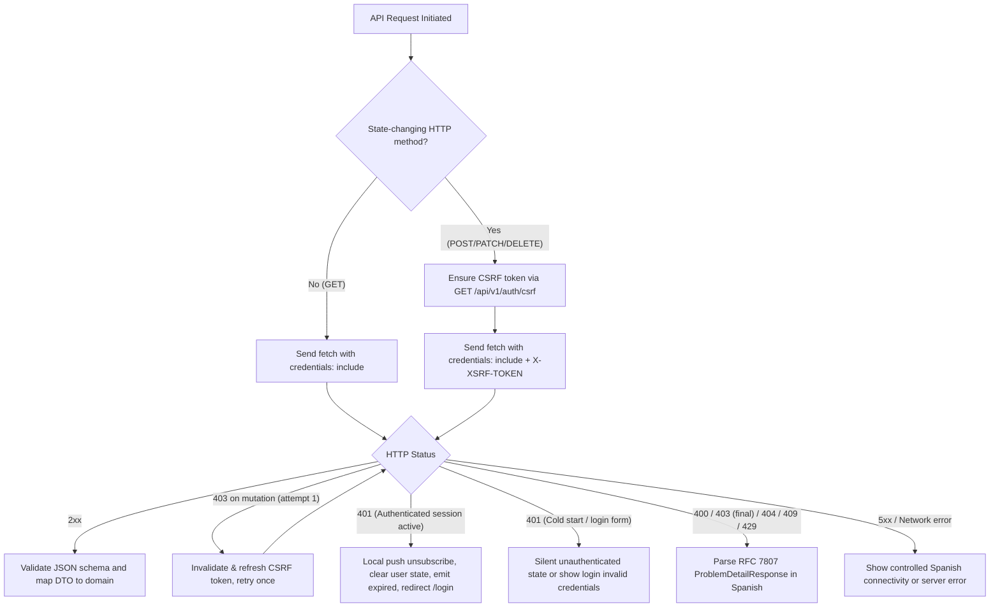

# Spec 006: Backend REST API Integration, Keyset Pagination & Web Push

- **Feature Name:** `006-backend-integration`
- **Status:** approved
- **Created Date:** 2026-11-19
- **Authors:** SDD Planner Agent
- **SRS / SVD References:** `RF-01`, `RF-02`, `RF-03`, `RF-04`, `RF-05`, `RF-06`, `RF-07`, `RF-12`, `RF-13`, `RF-14`, `RF-15`, `RF-16`, `RF-22`, `RF-24`, `RF-25`, `RF-27`, `RF-28`, `RF-29`, `UI-01`, `UI-02`, `UI-06`, `UI-07`, `RNF-01`, `RNF-04`, `RNF-05`, `RNF-06`, `RNF-07`, `RNF-08`, `RNF-09`, `RNF-10`, `RNF-12`, `RNF-14`, `RNF-15`, `RNF-16`, `RNF-18`, `RNF-19`, `RNF-20`, `Appendix A`, `Appendix B`, `Appendix D`, `Constitution Principles 1–6`

---

## 1. Purpose & Background

### 1.1 Purpose
Define the functional requirements, security transport boundaries, error-handling semantics, DTO-to-domain invariants, progressive Keyset pagination and server-filtering contracts, Web Push lifecycle, dual persistence mode switching, accessibility requirements, and Spanish localization contracts for integrating the Task by Task frontend MVP with the live **Task by Task REST API (`v1.0.0-mvp`)**. This specification connects the complete MVP frontend (`000-foundation` through `005-notifications`) to real server persistence while keeping `localStorage` offline/demo mode fully intact as the default mode.

### 1.2 Background
Specs `000` through `005` delivered the complete Task by Task MVP frontend against an isolated persistence boundary backed by `localStorage`. The separate backend repository now exposes the MVP REST API (`27` paths / `37` operations, OpenAPI `1.0.0-mvp`) implementing:
1. Cookie-based authentication (`HttpOnly`, `SameSite=Lax` `SESSION` cookie) and double-submit CSRF protection (`GET /api/v1/auth/csrf`, `XSRF-TOKEN` cookie, `X-XSRF-TOKEN` header).
2. Server-authoritative validation, rate limiting, and business-rule enforcement (`RNF-06`, `RNF-07`, `RNF-19`) returning localized Spanish RFC 7807 errors (`application/problem+json`) with structured field-level `invalidParams` on `400` and `retryAfterSeconds` on `429`.
3. Full CRUD and workflow endpoints for user accounts, individual groups, tasks (including move, copy, completion, and server-side filtering), group-scoped tags, and in-app notifications.
4. Keyset (`cursor` / `limit` / `hasNext`) pagination across groups, tasks, tags, and notifications to satisfy progressive loading (`RNF-04`).
5. Server-side due-date alert scheduling and W3C Web Push (VAPID RFC 8292) subscription endpoints (`/api/v1/notifications/push/*` plus logout `endpoint` cleanup) to deliver browser notifications even when the application tab is closed (`RF-27`, `RF-28`, `RF-29`).

To adopt the backend cleanly without breaking offline development, CI, or existing automated test suites:
- The application must support **dual persistence modes** selectable via environment variables, defaulting to `localStorage` when unset and activating `api` mode when explicitly configured.
- Local development must support same-origin `/api` proxying to the local backend (`http://localhost:8080`) with an optional base URL override for deployed or cross-origin environments.
- UI components must remain decoupled from raw HTTP calls and `localStorage` (`Constitution Principle 3`), and every inbound API response must be validated at runtime before entering application state.

---

## 2. Scope

### 2.1 In Scope
1. **Dual Persistence Mode & Environment Configuration (`Constitution Principle 3`, `RNF-08`):**
   - Environment-variable selection between `localStorage` (offline/demo mode, **default when unset**) and `api` (real HTTP REST backend mode), failing deterministically on invalid mode values.
   - Local development proxy mapping `/api` requests to `http://localhost:8080` so `HttpOnly` and `SameSite=Lax` cookies operate seamlessly on same-origin during development, plus an optional API base URL configuration for non-proxied deployments.
   - Native browser HTTP transport (`credentials: "include"` on every request, no third-party HTTP client libraries) with runtime schema validation of all inbound responses.
2. **Cookie Session & CSRF Lifecycle (`RF-01`, `RF-02`, `RNF-07`, `RNF-08`, `RNF-09`):**
   - Session verification via `GET /api/v1/users/me` using the `HttpOnly` `SESSION` cookie.
   - CSRF token bootstrap via `GET /api/v1/auth/csrf` and transmission of `X-XSRF-TOKEN` on every state-changing request (`POST`, `PATCH`, `PUT`, `DELETE`), including public auth mutations (`register`, `login`, `recover-password`) and `logout`.
   - Automatic CSRF token invalidation after authentication state changes and single-attempt CSRF refresh + retry on an initial `403` mutation response.
3. **RFC 7807 Spanish Error Handling, Rate Limiting & `401` Expiry (`RNF-06`, `RNF-07`, `RNF-09`, `RNF-14`, `RNF-18`):**
   - Standardized parsing of `application/problem+json` responses (`title`, `detail`, `status`, `instance`, `invalidParams`, `retryAfterSeconds`).
   - Mapping `400` `invalidParams` entries to matching form fields while surfacing general Spanish error feedback.
   - Formatting `429` cooldown messages from `retryAfterSeconds` across `/login`, `/register`, and `/recover` without duplicating client-side `localStorage` lockout counters in `api` mode.
   - Distinguishing cold-start unauthenticated `401` responses (silent redirect to `/login`), login `401` credential failures (generic error), and mid-session authenticated `401` responses (abort operation, clear user-scoped state, unsubscribe local Web Push best-effort, tear down notification runtime, redirect to `/login` with `sessionExpired`).
   - Controlled Spanish error recovery for `403`, `404`, `409`, `5xx`, and network/offline failures (`RNF-18`).
4. **Complete MVP REST Integration (`27` paths / `37` operations):**
   - **Auth (`RF-01`, `RF-02`, `RF-03`):** CSRF bootstrap, register, login (with browser timezone sync), logout (with optional Web Push `endpoint`), password recovery (accepting both `XXXX-XXXX` and `XXXXXXXX` formats with deterministic per-mode normalization).
   - **Users (`RF-04`, `RF-05`, `UI-06`, `UI-07`):** Get profile, update profile (including `24H`/`12H` time format and remaining recovery codes visibility), change password, regenerate recovery codes (shown once only), delete account (confirming with `password`).
   - **Groups (`RF-06`, `RF-07`, `RF-24`):** Paginated group listing (`Personal` first), single group lookup, create, rename, and delete non-Personal groups (`409` protection on `Personal`).
   - **Tasks (`RF-12`..`RF-16`, `RF-24`, `RF-25`):** Per-group paginated task listing with server-delegated `status` and `search` filters, cross-group filtered task query support (`groupIds`, `status`, `search`), task detail lookup, create, partial patch, completion toggle, move, copy, and delete.
   - **Tags (`RF-22`):** Paginated/searchable group tag listing, idempotent create-or-reuse (`200`/`201`), detach tag from task, and delete tag from group.
   - **Notifications (`RF-27`, `RF-28`, `RF-29`):** Paginated notification listing, unread count, mark single read, mark all read, delete notification, VAPID public key discovery, Web Push subscription registration/re-linking, and authenticated unregistration by endpoint or subscription ID.
5. **Keyset Pagination & Server-Delegated Filtering (`RNF-04`, `RF-24`, `RF-25`, `RF-29`):**
   - Progressive `"Cargar más"` controls driven by `cursor` and `hasNext` for groups (in the grid, group filter selector, and Move/Copy modals), per-group task cards, and the Notification Center.
   - Delegation of main status filter (`PENDING`, `COMPLETED`, `ALL`), title `search`, and selected `groupIds` to backend query parameters in `api` mode, with deterministic count-badge semantics when additional pages exist.
6. **Web Push (VAPID + Service Worker) & Notification Mode Separation (`RF-27`, `RF-28`, `RF-29`, `RF-02`, `RNF-15`, `RNF-18`):**
   - Disabling client-side due-alert timers and local alert synthesis in `api` mode because the backend schedules and persists due-date alerts.
   - Service Worker registration, `PushManager` subscription with the backend VAPID public key when `enabled === true` and permission is `'granted'`, incoming push payload parsing with safe Spanish fallbacks, notification click navigation to `/`, and logout / account-deletion / session-expiry cleanup.
   - Graceful degradation when VAPID is disabled (`enabled: false`), VAPID discovery fails (`5xx`/network), browser APIs are unavailable, or subscription fails.
7. **Zero Regression in `localStorage` Mode & Accessible Spanish Mobile-First UI (`UI-01`, `RNF-12`, `RNF-14`, `RNF-20`):**
   - Full preservation of all `000`–`005` behaviors in `localStorage` mode with zero network traffic.
   - Accessible, responsive Spanish UI for all progressive-loading, error, recovery-code count, and Web Push states.

### 2.2 Out of Scope
- All **Posterior** SRS features (`RF-08`..`RF-11`, `RF-17`..`RF-21`, `RF-23`, `RF-26`, `RF-30`..`RF-33`): shared groups, member roles, invitations, email flows, subtasks, pre-due reminders, recurring tasks, dedicated tag management screen, advanced filters, separate unified search results view (`RF-26`), analyst metrics, drag & drop, and real-time updates (WebSockets/SSE).
- Bidirectional sync or automated migration of data between `localStorage` mode and `api` mode.
- Third-party HTTP client libraries, OAuth/social login, or backend API modifications.

### 2.3 Cross-Spec Supersession & Integration Boundaries
This specification operates strictly within the MVP boundary and refines earlier client-only specifications **exclusively when running in `api` persistence mode** (leaving `localStorage` mode unchanged except for broadened recovery-code format acceptance):
1. **Authentication, Lockout & Recovery Code Format (`004-auth`):**
   - In `api` mode, password hashing (`RNF-05`), 7-day session persistence (`HttpOnly` cookie), recovery-code generation/storage, and rate-limit throttling (`RNF-06`) are enforced authoritatively by the backend. Client-side `localStorage` session records, password hashes, and login lockout counters are not used in `api` mode.
   - Client-side missing-`"Personal"` self-healing (`004-auth` `REQ-AU-21`) applies **exclusively** in `localStorage` mode; in `api` mode, the backend guarantees provisioning and immutability of each user's `"Personal"` group (`POST /api/v1/groups` creates only non-Personal individual groups).
   - Password recovery input validation (`004-auth` `REQ-AU-10`) is broadened across both modes to accept both hyphenated `XXXX-XXXX` and unhyphenated `XXXXXXXX` 8-character alphanumeric codes, normalized per mode (`REQ-BI-13`).
2. **Task Copy & Overdue Authoritative State (`001-tasks` `RF-14`, `RF-16`):**
   - In `api` mode, `POST /api/v1/tasks/{taskId}/copy` creates the copied task as pending (`completed: false`) and returns the authoritative `TaskResponse`; the frontend renders the exact task state returned by the server (`RNF-07`).
   - In `api` mode, visual overdue status for incomplete tasks uses the server-computed `TaskResponse.overdue` boolean (`RNF-07`, `RF-14`), whereas completed tasks always render strikethrough-only without overdue styling.
3. **Progressive Loading, Per-Group Pagination & Count Badges (`001-tasks`, `002-groups` `REQ-GRP-13`/`REQ-GRP-17`, `003-tags`):**
   - In `api` mode, workspace lists load incrementally via Keyset pagination (`RNF-04`) strictly within the **Groups Grid View** (`RF-24`, `UI-02`; no separate unified filtered results view is introduced in MVP).
   - Because `KeysetPageTaskResponse` returns only the active `status` page without a `totalCount` field:
     - Each group card badge (`002-groups` `REQ-GRP-13(1)`) displays the loaded matching count for that group, appending `+` (e.g., `20+ tareas`) whenever that group has `hasNext === true`.
     - Main filter tab badges (`002-groups` `REQ-GRP-17`) display the loaded count **only on the active status tab** (appending `+` when any visible group has `hasNext === true`) and omit numeric counts on the two inactive status tabs. `localStorage` mode retains exact counts on all three tabs.
4. **Due-Date Alerts & Browser Notifications (`005-notifications`):**
   - In `api` mode, the backend owns due-date alert scheduling (`RF-28`), notification creation, and 30-day retention (`RF-29`). Client-side due-alert timers and local `Notification` synthesis are disabled in `api` mode, replaced by server-backed Notification Center queries and W3C Web Push (Service Worker + VAPID) for native browser alerts (`RF-27`). The per-user 8-hour browser permission reminder cooldown and blocked-permission instructions remain active whenever server Web Push is enabled.
5. **Future-Proof Extensibility (`RNF-20`):**
   - Inbound `GroupResponse` DTOs (which omit `members` in the individual-only MVP backend) map into the frontend `Group` domain contract with `type: 'individual'` and a single creator member entry; `TaskResponse.assignedUserId` maps to `Task.assigneeId`; `NotificationResponse.eventType` validates as any non-empty string rather than a closed enum, preserving full compatibility with `Posterior` features.

---

## 3. Requirements (EARS Format)

### 3.1 Persistence Mode, Transport & Security Boundaries (`RNF-07`, `RNF-08`, `RNF-18`, `RNF-19`)

- **REQ-BI-01 (Ubiquitous - Dual Persistence Mode & Deterministic Validation):**  
  The system shall support two persistence modes selectable through environment configuration: `'localStorage'` (offline/demo mode) and `'api'` (real REST backend mode).
  1. When the persistence mode environment variable is unset or empty/whitespace, the system shall default to `'localStorage'` mode so offline development, CI checks, and existing automated tests continue functioning without a running backend.
  2. If the persistence mode environment variable is set to any value other than `'localStorage'` or `'api'`, the system shall fail deterministically at configuration resolution time with an explicit configuration error naming the invalid value and allowed modes, and shall never silently fall back or mix `localStorage` and HTTP calls.

- **REQ-BI-02 (Ubiquitous - Dev Proxy & Optional API Base URL):**  
  In `api` mode, when no explicit API base URL is configured, the system shall send requests to same-origin relative `/api/v1/...` paths—supported in local development by proxying `/api` to `http://localhost:8080` so `HttpOnly` `SameSite=Lax` cookies work seamlessly without cross-site friction. When an explicit API base URL environment variable is configured (e.g., for deployed environments over HTTPS per `RNF-08`), the system shall prefix API requests with that normalized base URL (trimming trailing slashes).

- **REQ-BI-03 (Ubiquitous - Credentialed Native HTTP Transport & Inbound Validation):**  
  In `api` mode, every HTTP request to the backend shall use the platform's native `fetch` capability with `credentials: "include"` so the `HttpOnly` `SESSION` cookie and `XSRF-TOKEN` cookie are always exchanged (`RNF-08`, `RNF-09`). Requests with a JSON body shall send `Content-Type: application/json`, and all requests shall declare `Accept: application/json, application/problem+json`. Every non-empty successful API response payload shall be validated against a runtime schema before entering application state; malformed or schema-violating payloads shall raise a controlled Spanish error (`errors.invalidResponse`) rather than corrupting UI state (`Constitution Principle 3`, `RNF-18`).

- **REQ-BI-04 (Event-Driven & Unwanted Behavior - CSRF Bootstrap, Header Injection & Deterministic `403` Retry):**  
  In `api` mode, before sending any state-changing request (`POST`, `PATCH`, `PUT`, `DELETE`)—including unauthenticated mutations (`POST /api/v1/auth/register`, `POST /api/v1/auth/login`, `POST /api/v1/auth/recover-password`) and `POST /api/v1/auth/logout`—the system shall ensure a valid CSRF token has been bootstrapped via `GET /api/v1/auth/csrf` and attach the token in the `X-XSRF-TOKEN` header (or the `headerName` returned by the bootstrap endpoint).
  1. Following login, registration, logout, account deletion, or mid-session `401` expiry, the system shall invalidate any cached CSRF token so the next mutation fetches a fresh token synchronized with the current session.
  2. When a state-changing request returns HTTP `403` on its first attempt, the system shall invalidate the cached CSRF token, fetch a fresh token via `GET /api/v1/auth/csrf`, and automatically retry the original mutation **at most once** with the refreshed header. If the retry succeeds (`2xx`) or returns another status (`400`/`401`/`404`/`409`), the system processes that outcome normally; if the retry still returns `403` (confirming a domain authorization denial or persistent rejection), the system shall stop retrying immediately and handle the `403` RFC 7807 response per `REQ-BI-09(2)`.

### 3.2 RFC 7807 Error Handling, Rate Limiting & Session Expiry (`RNF-06`, `RNF-07`, `RNF-09`, `RNF-14`, `RNF-18`)

- **REQ-BI-05 (Event-Driven - RFC 7807 Spanish Error Parsing):**  
  When any backend request returns a non-`2xx` HTTP response containing `application/problem+json`, the system shall parse the RFC 7807 `ProblemDetailResponse` (`type`, `title`, `status`, `detail`, `instance`, `invalidParams`, `retryAfterSeconds`) and present the backend's localized Spanish `detail` (falling back to `title`, and then to a centralized Spanish message from the localization dictionary when neither is present).

- **REQ-BI-06 (Event-Driven - Field-Level `400` Validation Mapping):**  
  When a mutation returns HTTP `400` with a non-empty `invalidParams` array (`{ name, reason }`), the system shall map each recognized field `name` to its corresponding form field error while displaying any unmapped or summary validation message (`detail`) cleanly in the active form or dialog, keeping user input intact (`RNF-07`, `RNF-19`). Client-side validation remains an immediate UX aid, while backend validation is always authoritative (`Constitution Principle 3`).

- **REQ-BI-07 (Event-Driven - Rate-Limit `429` Cooldown Handling):**  
  When `POST /api/v1/auth/login`, `POST /api/v1/auth/register`, or `POST /api/v1/auth/recover-password` returns HTTP `429` (`RNF-06`):
  1. If `retryAfterSeconds` is a positive finite number (`retryAfterSeconds > 0`), the system shall format a Spanish cooldown message:
     - When `retryAfterSeconds >= 60`, use `Math.ceil(retryAfterSeconds / 60)` minutes (`auth.tooManyAttemptsMinutes` on `/login`; `errors.rateLimitedMinutes` on `/register` and `/recover`).
     - When `0 < retryAfterSeconds < 60`, use `Math.max(1, Math.ceil(retryAfterSeconds))` seconds (`auth.tooManyAttemptsSeconds` on `/login`; `errors.rateLimitedSeconds` on `/register` and `/recover`).
  2. If `retryAfterSeconds` is absent, non-numeric, or `<= 0`, the system shall display the RFC 7807 `detail` when non-empty, falling back to `errors.tooManyRequests`.
  3. In `api` mode, the system shall not maintain separate client-side `localStorage` login-lockout counters.

- **REQ-BI-08 (Event-Driven & State-Driven - `401 Unauthorized` Cold-Start vs. Login vs. Mid-Session Expiry):**  
  The system shall handle HTTP `401` responses according to execution context (`RNF-09`, `RNF-18`):
  1. **Cold-start / unauthenticated session check:** When `GET /api/v1/users/me` returns `401` while no authenticated user is currently active in memory, the system shall mark the user unauthenticated and enforce unauthenticated routing to `/login` **without** displaying `auth.sessionExpired`.
  2. **Login credential rejection:** When `POST /api/v1/auth/login` returns `401`, the system shall keep the user on `/login` and display the generic Spanish authentication failure message (backend `detail` or `auth.invalidCredentials`) without disclosing account existence and without displaying `auth.sessionExpired`.
  3. **Mid-session expiration:** When any authenticated read or mutation returns `401` while an authenticated session was active in memory, the system shall abort the operation cleanly, perform best-effort **local** browser `PushSubscription.unsubscribe()` (without issuing any authenticated backend `DELETE` request), clear all user-scoped in-memory workspace/auth/notification state, emit the session-termination teardown signal, invalidate cached CSRF state, and redirect to `/login` displaying `auth.sessionExpired`.

- **REQ-BI-09 (Unwanted Behavior - Conflicts, Unavailable Resources & Network/Server Failures):**  
  The system shall recover gracefully from non-`401` backend and transport failures (`RNF-18`):
  1. **`409 Conflict`:** On registration or profile update, display the backend's Spanish conflict `detail` (email or username already registered) and keep the form open; on attempting to delete the `"Personal"` group, display the controlled Spanish error (`detail` or `groups.cannotDeletePersonal`) without removing the group.
  2. **`403 Forbidden` (after CSRF retry, or on GET) or `404 Not Found`:** If a group, task, tag, or notification is no longer accessible or no longer exists, display the controlled Spanish error message (`detail` or `errors.forbidden` / `errors.notFound`) and reconcile the UI to a valid workspace state (removing or refreshing stale items without unhandled errors, `RNF-18`).
  3. **Network failure / timeout / `5xx`:** Display a centralized Spanish connectivity or server error alert (`errors.networkError` or RFC 7807 `detail` / `errors.serverError`), preserve open modal/form inputs, and allow the user to retry.

### 3.3 Authentication, Profile & Account Lifecycle in API Mode (`RF-01`..`RF-05`, `UI-06`, `UI-07`, `RNF-05`, `RNF-09`, `RNF-10`)

- **REQ-BI-10 (Event-Driven - Session Bootstrap & Route Guarding):**  
  On application startup and protected/public route transitions in `api` mode, the system shall validate authentication state against `GET /api/v1/users/me` (avoiding redundant network round-trips when the authenticated user is already hydrated in memory unless a fresh validation is required, while immediately reacting to any subsequent `401` per `REQ-BI-08(3)`). On HTTP `200`, the system shall map `UserResponse` (`id` as string, `timezone` -> `timeZone`, `'24H'|'12H'` -> `'24h'|'12h'`, and `remainingRecoveryCodes`) into active user state and enforce the existing route access matrix (`004-auth` Section 4.2).

- **REQ-BI-11 (Event-Driven - Account Registration & One-Time Recovery Codes):**  
  When a user submits valid registration details on `/register` in `api` mode (`RF-01`, `RF-06`), the system shall send `POST /api/v1/auth/register` with `{ email, username, displayName, password, timezone }` (passing the detected browser IANA timezone, defaulting to `'UTC'` if unavailable). On HTTP `201`, the system shall hydrate the authenticated `user` from `RegisterResponse.user`, store `RegisterResponse.recoveryCodes` strictly in transient in-memory view state on `/register`, and display those 8 codes once only alongside `RegisterResponse.recoveryCodesNotice` (falling back to `auth.recoveryCodesWarning`), preserving all ephemeral dismissal and reload-clearing invariants from `004-auth`.

- **REQ-BI-12 (Event-Driven - Sign-In with Timezone Sync & Logout):**  
  1. When a user submits valid login credentials on `/login` in `api` mode (`RF-02`), the system shall send `POST /api/v1/auth/login` with `{ email, password, timezone }` (supplying the current browser IANA timezone so the backend refreshes the user's timezone on login). On HTTP `200`, the system shall hydrate `UserResponse` and navigate to `/`.
  2. When an authenticated user activates `"Cerrar sesión"` in `api` mode (`RF-02`), the system shall retrieve any active browser Web Push subscription endpoint (best-effort) **prior** to calling logout, send `POST /api/v1/auth/logout` with `{ endpoint }` when an endpoint exists (or an empty/omitted body otherwise), perform best-effort local browser `PushSubscription.unsubscribe()`, clear all user-scoped in-memory state, emit session-end teardown, invalidate the cached CSRF token, and redirect cleanly to `/login` without displaying `auth.sessionExpired`. Even if `POST /api/v1/auth/logout` returns `401`, the client shall complete local cleanup cleanly without displaying `auth.sessionExpired`.

- **REQ-BI-13 (Event-Driven - Password Recovery & Deterministic Dual Recovery-Code Normalization):**  
  On `/recover` (`RF-03`), the system shall validate and normalize recovery codes deterministically across both persistence modes:
  1. **Accepted Input Formats:** After trimming whitespace, the input shall accept either an unhyphenated 8-character ASCII alphanumeric code (`^[A-Za-z0-9]{8}$`, e.g., `A1B2C3D4`) or a hyphenated `XXXX-XXXX` code (`^[A-Za-z0-9]{4}-[A-Za-z0-9]{4}$`, e.g., `A1B2-C3D4`), case-insensitive on input.
  2. **Validation Error Reconciliation (`004-auth` `REQ-AU-10`):**
     - Empty after trim -> `auth.recoveryCodeRequired`.
     - Characters outside `[A-Za-z0-9-]` or malformed hyphen placement (multiple hyphens or hyphen not splitting two 4-character segments when a hyphen is present) -> `auth.recoveryCodeFormatError`.
     - Alphanumeric character count (ignoring an optional single middle hyphen) not equal to `8` -> `auth.recoveryCodeLengthError`.
  3. **Mode-Specific Canonical Normalization:**
     - In **`localStorage` mode**, strip any optional hyphen and uppercase to canonical `XXXXXXXX` before matching stored 8-character `RecoveryCode` records.
     - In **`api` mode**, normalize to uppercase hyphenated `XXXX-XXXX` (`${raw8.slice(0, 4)}-${raw8.slice(4, 8)}`) before sending `POST /api/v1/auth/recover-password` with `{ email, recoveryCode, newPassword }`, matching the backend's `XXXX-XXXX` format regardless of whether the user typed the hyphen.
  4. On HTTP `200`, the system shall display `MessageResponse.message` (or `auth.recoverSuccess`) as a login notice and direct the user to `/login`.

- **REQ-BI-14 (Event-Driven - Profile Update, Password Change, Recovery Code Regeneration & Account Deletion):**  
  While authenticated on `/profile` in `api` mode (`RF-04`, `RF-05`, `UI-06`, `UI-07`, `RNF-09`, `RNF-10`):
  1. **Profile & Preferences:** Submitting profile changes shall send `PATCH /api/v1/users/me` with `{ displayName, username, email, timeFormat }` (mapping `'24h'` -> `'24H'` and `'12h'` -> `'12H'`; `timeZone` remains read-only on `/profile` per `RF-04` and is not edited from this form), update active user state from the returned `UserResponse`, propagate `timeFormat` across task display and due-time capture (`UI-07`), and show `auth.profileSaved`. When `remainingRecoveryCodes` is present on the user profile, the recovery-codes section shall display `auth.remainingRecoveryCodes`.
  2. **Password Change:** Submitting a password change shall send `POST /api/v1/users/me/password` with `{ currentPassword, newPassword }`. On HTTP `200`, the user remains signed in, password fields reset, and confirmation (`MessageResponse.message` or `auth.passwordChanged`) is displayed.
  3. **Recovery Code Regeneration:** Submitting regeneration shall send `POST /api/v1/users/me/recovery-codes/regenerate` with `{ currentPassword }`. On HTTP `200`, the system shall display the 8 returned `RecoveryCodesResponse.recoveryCodes` once only in transient view state with `recoveryCodesNotice` (or `auth.recoveryCodesWarning`) and update `remainingRecoveryCodes` to `8`.
  4. **Account Deletion:** Confirming permanent account deletion in the destructive confirmation modal (`UI-06`) shall send `DELETE /api/v1/users/me` with `{ password: currentPassword }` (matching `DeleteAccountRequest`). On HTTP `204`, the system shall best-effort unsubscribe any active local browser `PushSubscription`, clear all user-scoped in-memory state, emit session-end teardown (`deleted`), invalidate cached CSRF state, and redirect to `/login` displaying `auth.accountDeleted` (without `auth.sessionExpired`).

### 3.4 Groups, Tasks, Tags, Keyset Pagination & Server-Delegated Filtering (`RF-06`, `RF-07`, `RF-12`..`RF-16`, `RF-22`, `RF-24`, `RF-25`, `RNF-04`, `RNF-16`, `RNF-20`)

- **REQ-BI-15 (Event-Driven & State-Driven - Groups CRUD, Keyset Pagination & Partial-List Edge Cases):**  
  In `api` mode (`RF-06`, `RF-07`, `RF-16`, `RF-24`, `RF-25`, `RNF-04`):
  1. Workspace initialization and manual refresh shall fetch the first page of groups from `GET /api/v1/groups` (`cursor`, `limit` 1..50, default 20). Each `GroupResponse` shall map into the domain `Group` contract preserving `isPersonal`, `creatorId` (as string), `type: 'individual'`, and a single creator membership entry (`RNF-20`).
  2. Whenever `KeysetPageGroupResponse.hasNext === true` and `nextCursor !== null`, the system shall render an accessible `"Cargar más grupos"` control (`groups.loadMoreGroups`) that requests the next page via `GET /api/v1/groups?cursor=<nextCursor>&limit=<limit>`, appends deduplicated groups, and preserves deterministic server ordering (`isPersonal` first, `createdAt ASC`, `id ASC`) without resetting active filters.
  3. **Paginated-Group Interaction Rules when `groupsHasNext === true`:**
     - **Group filter selector (`002-groups` `REQ-GRP-19`):** Displays `"Todos los grupos"` plus all currently loaded groups, exposes `"Cargar más grupos"` alongside the selector while `groupsHasNext === true`, and preserves `selectedGroupIds` across page loads.
     - **`"Mover a…"` / `"Copiar a…"` modals (`RF-16`):** List all currently loaded valid destination groups (`individual` groups; excluding the source group for `"Mover a…"` and including all loaded groups for `"Copiar a…"`), expose `"Cargar más grupos"` directly inside the modal whenever `groupsHasNext === true`, and do not display `tasks.noOtherGroups` while additional unloaded group pages remain available.
     - **Newly created group insertion (`POST /api/v1/groups`):** Immediately append the newly created `GroupResponse` to the loaded groups list so it is visible without waiting for remaining pages; when later pages load via `"Cargar más grupos"`, deduplicate by `id` and sort deterministically (`isPersonal` first, `createdAt ASC`, `id ASC`) so the created group never duplicates.
  4. Single-group lookup (when reconciling a specific group) shall use `GET /api/v1/groups/{groupId}`.
  5. Creating a group shall call `POST /api/v1/groups` (`{ name }`, `201`), renaming any group (including `"Personal"`) shall call `PATCH /api/v1/groups/{groupId}` (`{ name }`, `200`), and deleting a non-Personal group shall call `DELETE /api/v1/groups/{groupId}` (`204`) after confirmation (`UI-06`), removing the group and its cached tasks/tags from workspace state.

- **REQ-BI-16 (Event-Driven & State-Driven - Per-Group Task Pagination, Server Filtering & Count Badges):**  
  In `api` mode (`RF-15`, `RF-24`, `RF-25`, `UI-02`, `RNF-04`, `RNF-16`):
  1. **Per-Group Card Loading & Pagination (`GET /api/v1/groups/{groupId}/tasks`):** Each visible group card in the Groups Grid View shall load its tasks from `GET /api/v1/groups/{groupId}/tasks` passing the active main filter (`'pendientes'` -> `PENDING`, `'completadas'` -> `COMPLETED`, `'todas'` -> `ALL`), optional trimmed `search`, optional `cursor`, and `limit` (1..50, default 20). Each group card shall maintain its own independent pagination state (`nextCursor`, `hasNext`, loading-more flag) and, whenever `hasNext === true` and `nextCursor !== null`, render an accessible `"Cargar más tareas"` control (`tasks.loadMoreTasks`) inside that group card to append subsequent deduplicated pages in server fixed order (`RF-15`: `completed ASC` in `ALL`, `dueDate ASC NULLS LAST`, `dueTime ASC NULLS LAST`, `createdAt ASC`, `id ASC`).
  2. **Cross-Group Query Endpoint (`GET /api/v1/tasks`):** The API task data contract shall also integrate `GET /api/v1/tasks` (`groupIds`, `status`, `search`, `cursor`, `limit`) for cross-group filtered queries (such as evaluating global search match presence across selected/all groups when `search` is active and unloaded group pages exist). Changing `status`, `search` (debounced to avoid redundant per-keystroke requests, discarding stale out-of-order responses), or `selectedGroupIds`, or clicking manual refresh (`RF-24`, `RNF-16`), resets per-group task cursors and re-queries the server with the latest filter combination.
  3. **Count Badges in `api` Mode (refining `002-groups` `REQ-GRP-13(1)` & `REQ-GRP-17`):**
     - Each group card count badge displays the count of loaded matching tasks for that group (`groups.taskCount(n)` when `hasNext === false`; `groups.taskCountAtLeast(n)` — e.g., `20+ tareas` — when `hasNext === true`).
     - The main filter toolbar displays a loaded count badge **only on the currently active status tab** (e.g., `(N)` when all visible groups have `hasNext === false`, or `(N+)` when any visible group has `hasNext === true`) and omits numeric counts on the two inactive status tabs.
  4. Individual task detail lookup (for reconciling stale state or opening a task not yet cached) shall support `GET /api/v1/tasks/{taskId}`.

- **REQ-BI-17 (Event-Driven - Task Mutations: Create, Patch, Completion, Move, Copy, Delete & DTO Mapping):**  
  In `api` mode (`RF-12`, `RF-13`, `RF-14`, `RF-16`, `RNF-07`):
  1. **Create:** Submitting the create-task form shall call `POST /api/v1/groups/{groupId}/tasks` with `{ title, description, dueDate, dueTime, tags }` (sending trimmed tag names as `string[]`, `null` for omitted optional fields) and integrate the returned `201 TaskResponse` into workspace state.
  2. **Edit (Partial Patch):** Submitting the edit-task form shall call `PATCH /api/v1/tasks/{taskId}` sending modified fields, explicitly passing `null` for `description`, `dueDate`, `dueTime`, or `tags` (or `[]` for `tags`) when cleared by the user and never sending `title: null`, then updating workspace state from the returned `200 TaskResponse`.
  3. **Completion Toggle:** Checking or unchecking a task shall call `PATCH /api/v1/tasks/{taskId}/completion` with `{ completed: boolean }` and update the task from the returned `200 TaskResponse`.
  4. **Move:** Confirming `"Mover a…"` shall call `POST /api/v1/tasks/{taskId}/move` with `{ targetGroupId: number }` and update workspace tasks and destination group tags from the returned `200 TaskResponse` (preserving original `createdAt`).
  5. **Copy:** Confirming `"Copiar a…"` shall call `POST /api/v1/tasks/{taskId}/copy` with `{ targetGroupId: number }` and insert the newly created `201 TaskResponse` into workspace state (treating the backend's returned `id`, `createdAt`, `completed` state, `overdue`, and resolved target-group `tags` as authoritative).
  6. **Delete:** Confirming task deletion shall call `DELETE /api/v1/tasks/{taskId}` (`204`) and remove the task from workspace state.
  7. **DTO Normalization & Overdue Rendering (`RF-14`, `RNF-07`):** Inbound `TaskResponse` values shall validate and normalize `id`, `groupId`, and `assignedUserId` (nullable) to string IDs, normalize `dueTime` from `HH:mm[:ss]` to canonical `HH:mm`, extract embedded `tags: TagResponse[]` into both the task's `tagIds` and the group's tag catalog, and preserve the validated server-computed boolean `overdue`. Completed tasks (`completed === true`) shall never display overdue styling; incomplete tasks (`completed === false`) in `api` mode shall use the server-computed `overdue` boolean as authoritative for overdue badge/color rendering (`UI-04`).

- **REQ-BI-18 (Event-Driven - Group-Scoped Tags Search, Reuse & Removal):**  
  In `api` mode (`RF-22`, `UI-06`, `RNF-04`):
  1. Loading tag suggestions for a group (and filtering suggestions as the user types) shall query `GET /api/v1/groups/{groupId}/tags` with optional `query`, `cursor`, and `limit`.
  2. Explicitly creating or reusing a tag in a group shall call `POST /api/v1/groups/{groupId}/tags` with `{ name }`, treating both HTTP `200` (existing tag reused case-insensitively) and HTTP `201` (new tag created) as successful tag resolution without error.
  3. Removing a tag with `"Solo de la tarea"` shall call `DELETE /api/v1/tasks/{taskId}/tags/{tagId}` (`204`) and detach that tag only from the target task while retaining it in the group catalog.
  4. Removing a tag with `"Del grupo"` (after confirmation per `UI-06`) shall call `DELETE /api/v1/groups/{groupId}/tags/{tagId}` (`204`) and remove that tag from the group catalog and from every loaded task in that group.

### 3.5 Server Notification Center & Web Push (VAPID + Service Worker) in API Mode (`RF-27`, `RF-28`, `RF-29`, `RF-02`, `RNF-04`, `RNF-15`, `RNF-18`)

- **REQ-BI-19 (Event-Driven & State-Driven - Server Notification Center & Keyset Pagination):**  
  In `api` mode (`RF-28`, `RF-29`, `RNF-04`, `RNF-16`, `RNF-20`):
  1. **Disable Local Due-Alert Scheduler:** The system shall **not** run client-side due-date timers, catch-up alert synthesis, or local notification creation in `api` mode; the backend is the single source of truth for due-date alert scheduling, notification creation, and 30-day retention.
  2. **Unread Count & Paginated Listing:** On authenticated workspace initialization and manual refresh, the system shall fetch the active unread badge count via `GET /api/v1/notifications/unread-count`. When opening the Notification Center panel (and on manual refresh while open), the system shall fetch the first page of notifications via `GET /api/v1/notifications` (`limit`, optional `cursor`, optional `unreadOnly`), validating `eventType` as any non-empty string (`RNF-20`). Whenever `KeysetPageNotificationResponse.hasNext === true` and `nextCursor !== null`, the Notification Center panel shall render an accessible `"Cargar más notificaciones"` control (`notifications.loadMoreNotifications`) to append the next page incrementally.
  3. **Read & Delete Actions:** Activating `"Marcar como leída"` shall call `PATCH /api/v1/notifications/{notificationId}/read` (`200`) and update the item and unread count; activating `"Marcar todas como leídas"` shall call `PATCH /api/v1/notifications/read-all` (`200 MarkAllReadResponse`) and mark all loaded notifications read while setting `unreadCount` to `0`; activating `"Eliminar"` shall call `DELETE /api/v1/notifications/{notificationId}` (`204`) and remove the item (decrementing `unreadCount` if it was unread).

- **REQ-BI-20 (Event-Driven & State-Driven - Web Push VAPID Discovery, Service Worker & Subscription Lifecycle):**  
  In `api` mode (`RF-27`, `RF-28`):
  1. On authenticated workspace entry, the system shall query `GET /api/v1/notifications/push/vapid-public-key` to obtain `{ enabled, publicKey }`.
  2. While `enabled === true` and `publicKey` is a non-empty Base64URL string, if the browser supports Service Workers, `PushManager`, and `Notification`:
     - When permission is `'default'` or `'denied'`, the system shall enforce the existing per-user 8-hour browser permission reminder cooldown banner and blocked-permission reactivation guidance (`005-notifications` `REQ-NT-02`..`REQ-NT-04`).
     - When permission is `'granted'` (already granted on entry or newly granted after clicking `"Activar avisos"`), the system shall register the application Service Worker, obtain the existing browser `PushSubscription` or subscribe via `PushManager.subscribe({ userVisibleOnly: true, applicationServerKey })` using the decoded VAPID `publicKey`, extract `endpoint`, `keys.p256dh`, and `keys.auth`, and submit them to `POST /api/v1/notifications/push/subscriptions` (treating both `200` updated/re-linked and `201` created as success).
  3. **Service Worker Push Display & Click Contract:** The registered Service Worker shall handle incoming `push` events safely:
     - Attempt to parse the event payload as JSON (`{ title?, body?, content?, message?, url? }`): resolve title from non-empty `title` (default `'Task by Task — Aviso de vencimiento'`), resolve body from non-empty `body ?? content ?? message` (falling back to non-empty raw text when payload is non-JSON plain text, and to `'Tienes una nueva notificación de tarea pendiente.'` when payload is missing or empty), and resolve click navigation target from same-origin relative `url` (default `'/'`).
     - Malformed JSON or empty payloads shall never throw unhandled errors and shall still display the Spanish fallback notification.
     - Handling `notificationclick` shall close the notification and focus an existing Task by Task browser client window or open the resolved same-origin target (`'/'`).
  4. **Authenticated Subscription Removal Support:** The API notification boundary shall also support explicit authenticated unregistration via both `DELETE /api/v1/notifications/push/subscriptions?endpoint=<url>` and `DELETE /api/v1/notifications/push/subscriptions/{subscriptionId}` (`204`), invoked only while an active authenticated session exists.

- **REQ-BI-21 (Unwanted Behavior / Graceful Degradation - Web Push Disabled, Unavailable or Unsupported):**  
  In `api` mode (`RF-27`, `RNF-15`, `RNF-18`):
  1. If `GET /api/v1/notifications/push/vapid-public-key` returns `{ enabled: false, publicKey: null }` (or a null/empty `publicKey`), the system shall **not** register a push subscription, shall suppress the automatic browser permission reminder banner, shall display `notifications.pushDisabledByServer` inside the Notification Center status section, and shall keep all in-app Notification Center features fully functional.
  2. If `GET /api/v1/notifications/push/vapid-public-key` fails with a network error or `5xx` (non-`401`) response on workspace entry, the system shall treat Web Push as temporarily unavailable for the current load: do not block workspace rendering, suppress the automatic permission reminder banner, display `notifications.pushUnavailableStatus` inside the Notification Center status section, keep the in-app Notification Center operational, and re-attempt VAPID discovery on the next manual refresh or workspace load. (A `401` response triggers `REQ-BI-08(3)`.)
  3. If the browser does not support Service Workers, `PushManager`, or `Notification`, or if Service Worker registration or `PushManager.subscribe` fails, the system shall catch the failure gracefully without throwing unhandled errors, keep the workspace and Notification Center operational, and reflect the appropriate Spanish status (`notifications.permissionUnsupportedNote` or `notifications.pushSubscriptionError`) inside the Notification Center panel.

- **REQ-BI-22 (Event-Driven - Web Push Cleanup on Logout, Session Expiry & Account Deletion):**  
  In `api` mode (`RF-02`, `RF-05`, `RF-27`):
  1. **Explicit Logout:** Before calling `POST /api/v1/auth/logout`, inspect the active Service Worker `PushSubscription` (if any) and include `{ endpoint }` in `POST /api/v1/auth/logout` so the backend atomically invalidates the session and removes that device subscription; immediately after logout completes (or returns `401`), perform best-effort local browser `PushSubscription.unsubscribe()`. The client shall **never** issue authenticated `DELETE /api/v1/notifications/push/subscriptions` after `POST /api/v1/auth/logout` has already invalidated the session.
  2. **Account Deletion:** After `DELETE /api/v1/users/me` succeeds (`204`, server cascades all subscriptions), perform best-effort local browser `PushSubscription.unsubscribe()`.
  3. **Mid-Session `401` Expiry:** Upon mid-session `401` termination (`REQ-BI-08(3)`), perform best-effort local browser `PushSubscription.unsubscribe()` without issuing any authenticated backend `DELETE` call.

### 3.6 Dual-Mode Isolation, Accessibility & Localization (`UI-01`, `RNF-12`, `RNF-14`, `RNF-20`)

- **REQ-BI-23 (Ubiquitous - Zero Regression in `localStorage` Mode):**  
  While running in `localStorage` mode (the default), the system shall preserve 100% of existing behavior specified in `000-foundation` through `005-notifications`—including local repositories, client-side password hashing, client-side login lockout, client-side missing-`"Personal"` self-healing, client-side due-alert scheduling, client-side filtering/sorting with exact tab and group counts, and zero outbound HTTP requests or Service Worker registrations.

- **REQ-BI-24 (Ubiquitous - Responsive Mobile-First UI, Accessibility & Spanish Copy):**  
  All UI additions introduced by backend integration—`"Cargar más"` progressive loading controls (groups grid, group filter selector, Move/Copy modals, per-group task cards, Notification Center), loading-more states, RFC 7807 error alerts, remaining recovery codes count on `/profile`, and Web Push disabled/unavailable/error status indicators—shall render cleanly from ~375px mobile widths to desktop (`UI-01`), support full keyboard navigation (`Tab`, `Enter`, `Space`) with visible focus indicators, provide descriptive Spanish `aria-label` / `role="alert"` / `role="status"` attributes (`RNF-12`), and centralize 100% of frontend-owned UI copy in the Spanish localization dictionary (`RNF-14`).

---

## 4. Domain Models & Specifications

### 4.1 Persistence Mode Configuration & OpenAPI Endpoint Mapping (`v1.0.0-mvp`)

```
Environment Configuration Contract:
- Persistence Mode Selector (VITE_PERSISTENCE_MODE): 'localStorage' | 'api'
  - Default when unset or empty/whitespace: 'localStorage'
  - Any other value: fail deterministically with explicit configuration error
- Optional API Base URL (VITE_API_BASE_URL): string | undefined
  - Default when unset or empty: '' (same-origin relative '/api/v1/...', proxied to http://localhost:8080 in dev)

Inbound / Outbound DTO-to-Domain Mapping Invariants:
1. Identifiers: Backend int64 IDs (User, Group, Task, Tag, Notification, PushSubscription, assignedUserId)
   map to canonical non-empty string IDs inbound (String(id)) and validated integer IDs outbound (Number(id)).
2. User Mapping:
   - UserResponse.email: inbound schema allows up to 255 chars (matching OpenAPI maxLength: 255);
     client forms continue validating Appendix B <= 254 chars
   - UserResponse.timezone <-> User.timeZone
   - UserResponse.timeFormat ('24H' | '12H') <-> User.timeFormat ('24h' | '12h')
   - UserResponse.remainingRecoveryCodes (0..8) -> optional User.remainingRecoveryCodes
   - UserResponse omits passwordHash (never transmitted or stored in API mode)
3. Group Mapping (RNF-20 Compatibility):
   - GroupResponse { id, name, isPersonal, creatorId, createdAt, updatedAt }
   - Mapped to Group with type: 'individual' and members: [{ userId: String(creatorId), role: 'creator', joinedAt: createdAt }]
4. Task Mapping:
   - TaskResponse.assignedUserId <-> Task.assigneeId
   - TaskResponse.overdue (boolean) -> preserved as Task.overdue?: boolean (authoritative for incomplete tasks in API mode)
   - TaskResponse.dueTime ('HH:mm' or 'HH:mm:ss') -> normalized to canonical 'HH:mm' (or null)
   - TaskResponse.tags (TagResponse[]) -> populates Task.tagIds AND updates local group Tag cache
   - CreateTaskRequest / UpdateTaskPatchRequest send tag names (string[]), not tag IDs
   - ISO-8601 UTC instants (createdAt, completedAt, updatedAt) may include 0..9 fractional digits or timezone offsets
5. Recovery Codes & Account Deletion:
   - Recovery input accepts 'XXXX-XXXX' and 'XXXXXXXX' (trimmed, case-insensitive)
   - Normalization: localStorage -> 'XXXXXXXX' uppercase; api -> 'XXXX-XXXX' uppercase
   - DeleteAccountRequest uses { password } (not currentPassword)
   - ChangePasswordRequest uses { currentPassword, newPassword }
   - RegenerateRecoveryCodesRequest uses { currentPassword }
6. Notifications & Web Push:
   - NotificationResponse { id, eventType (any non-empty string; e.g. 'TASK_DUE'), content, read, createdAt } -> scoped to active User.id
   - KeysetPage<T> { content: T[], nextCursor: string | null, hasNext: boolean, size: number }
   - VapidPublicKeyResponse { enabled: boolean, publicKey: string | null }
   - RegisterPushSubscriptionRequest { endpoint: string, keys: { p256dh: string, auth: string } }
7. RFC 7807 Error Contract (application/problem+json):
   - ProblemDetailResponse { type?, title?, status?, detail?, instance?, invalidParams?: [{ name, reason }], retryAfterSeconds?: number }
```

#### Complete Backend API Surface Coverage (`27` Paths / `37` Operations)

| Domain | Method & Path | Purpose & Requirement |
| :--- | :--- | :--- |
| **Auth** | `GET /api/v1/auth/csrf` | Bootstrap `XSRF-TOKEN` cookie & `X-XSRF-TOKEN` value (`REQ-BI-04`) |
| **Auth** | `POST /api/v1/auth/register` | Create account, Personal group, 8 codes, `SESSION` cookie (`REQ-BI-11`) |
| **Auth** | `POST /api/v1/auth/login` | Authenticate, sync IANA `timezone`, issue `SESSION` cookie (`REQ-BI-12`) |
| **Auth** | `POST /api/v1/auth/logout` | Invalidate session & optionally delete device push `endpoint` (`REQ-BI-12`, `REQ-BI-22`) |
| **Auth** | `POST /api/v1/auth/recover-password` | Consume single-use `XXXX-XXXX` code & reset password (`REQ-BI-13`) |
| **Users** | `GET /api/v1/users/me` | Validate session cookie & hydrate current user profile (`REQ-BI-10`) |
| **Users** | `PATCH /api/v1/users/me` | Update profile fields and `24H`/`12H` `timeFormat` (`REQ-BI-14`) |
| **Users** | `POST /api/v1/users/me/password` | Change password requiring `currentPassword` (`REQ-BI-14`) |
| **Users** | `POST /api/v1/users/me/recovery-codes/regenerate` | Invalidate old codes & return 8 fresh one-time codes (`REQ-BI-14`) |
| **Users** | `DELETE /api/v1/users/me` | Permanently delete account & cascade data with `{ password }` (`REQ-BI-14`, `REQ-BI-22`) |
| **Groups** | `GET /api/v1/groups` | Keyset-paginated user groups (`Personal` first) (`REQ-BI-15`) |
| **Groups** | `POST /api/v1/groups` | Create individual group (`REQ-BI-15`) |
| **Groups** | `GET /api/v1/groups/{groupId}` | Fetch single group details (`REQ-BI-15`) |
| **Groups** | `PATCH /api/v1/groups/{groupId}` | Rename group (including `Personal`) (`REQ-BI-15`) |
| **Groups** | `DELETE /api/v1/groups/{groupId}` | Cascade-delete non-Personal group (`409` on `Personal`) (`REQ-BI-15`) |
| **Tasks** | `GET /api/v1/tasks` | Cross-group keyset-paginated task queries (`groupIds`, `status`, `search`) (`REQ-BI-16`) |
| **Tasks** | `GET /api/v1/groups/{groupId}/tasks` | Per-group card keyset-paginated tasks (`status`, `search`) (`REQ-BI-16`) |
| **Tasks** | `POST /api/v1/groups/{groupId}/tasks` | Create task in group with optional due date/time & tag names (`REQ-BI-17`) |
| **Tasks** | `GET /api/v1/tasks/{taskId}` | Fetch single task detail (`REQ-BI-16`) |
| **Tasks** | `PATCH /api/v1/tasks/{taskId}` | Partial task update supporting explicit `null` clears (`REQ-BI-17`) |
| **Tasks** | `DELETE /api/v1/tasks/{taskId}` | Permanently delete task & server due job (`REQ-BI-17`) |
| **Tasks** | `PATCH /api/v1/tasks/{taskId}/completion` | Mark task completed or pending (`REQ-BI-17`) |
| **Tasks** | `POST /api/v1/tasks/{taskId}/move` | Move task to target group preserving `createdAt` (`REQ-BI-17`) |
| **Tasks** | `POST /api/v1/tasks/{taskId}/copy` | Copy task to target group returning authoritative `TaskResponse` (`REQ-BI-17`) |
| **Tasks** | `DELETE /api/v1/tasks/{taskId}/tags/{tagId}` | Detach tag from single task (`REQ-BI-18`) |
| **Tags** | `GET /api/v1/groups/{groupId}/tags` | Keyset-paginated/searchable group tags (`REQ-BI-18`) |
| **Tags** | `POST /api/v1/groups/{groupId}/tags` | Create (`201`) or reuse (`200`) tag in group (`REQ-BI-18`) |
| **Tags** | `DELETE /api/v1/groups/{groupId}/tags/{tagId}` | Delete tag permanently from group & its tasks (`REQ-BI-18`) |
| **Notifications** | `GET /api/v1/notifications` | Keyset-paginated notification center listing (`REQ-BI-19`) |
| **Notifications** | `GET /api/v1/notifications/unread-count` | Current unread notification badge count (`REQ-BI-19`) |
| **Notifications** | `PATCH /api/v1/notifications/{notificationId}/read` | Mark single notification read (`REQ-BI-19`) |
| **Notifications** | `PATCH /api/v1/notifications/read-all` | Mark all notifications read (`REQ-BI-19`) |
| **Notifications** | `DELETE /api/v1/notifications/{notificationId}` | Permanently delete single notification (`REQ-BI-19`) |
| **Web Push** | `GET /api/v1/notifications/push/vapid-public-key` | Query server Web Push enabled status & VAPID public key (`REQ-BI-20`, `REQ-BI-21`) |
| **Web Push** | `POST /api/v1/notifications/push/subscriptions` | Register (`201`) or re-link (`200`) browser PushSubscription (`REQ-BI-20`) |
| **Web Push** | `DELETE /api/v1/notifications/push/subscriptions` | Authenticated idempotent unregister by `endpoint` query param (`REQ-BI-20`) |
| **Web Push** | `DELETE /api/v1/notifications/push/subscriptions/{subscriptionId}` | Authenticated delete of specific Web Push subscription by ID (`REQ-BI-20`) |

### 4.2 Session, CSRF & Error Handling State Transitions



### 4.3 Spanish Localization Contract (`RNF-14`)

Additive centralized Spanish copy (extending existing `common`, `errors`, `auth`, `groups`, `tasks`, and `notifications` namespaces without breaking existing keys):

- **Common (`common`):**
  - `loadingMore`: `'Cargando más...'`
- **Transport & API Fallback Errors (`errors`):**
  - `networkError`: `'No se pudo conectar con el servidor. Verifica tu conexión e intenta de nuevo.'`
  - `serverError`: `'El servidor no pudo completar la solicitud en este momento. Intenta de nuevo más tarde.'`
  - `tooManyRequests`: `'Demasiadas solicitudes en poco tiempo. Espera un momento e intenta de nuevo.'`
  - `rateLimitedMinutes`: `'Demasiadas solicitudes. Espera {minutes} min antes de intentar de nuevo.'`
  - `rateLimitedSeconds`: `'Demasiadas solicitudes. Espera {seconds} s antes de intentar de nuevo.'`
  - `invalidResponse`: `'La respuesta del servidor no tiene el formato esperado.'`
  - `forbidden`: `'No tienes permiso para realizar esta acción.'`
- **Auth & Profile (`auth`):**
  - `recoveryCodePlaceholder`: `'Ej. A1B2-C3D4 o 8 caracteres'`
  - `recoveryCodeLengthError`: `'El código de recuperación debe tener exactamente 8 caracteres alfanuméricos (ej. A1B2-C3D4).'`
  - `recoveryCodeFormatError`: `'El código de recuperación solo puede contener letras, números y un guion opcional en el formato XXXX-XXXX.'`
  - `remainingRecoveryCodes`: `'Códigos de recuperación disponibles: {count} de 8'`
- **Progressive Loading & Counts (`groups`, `tasks`, `notifications`):**
  - `groups.loadMoreGroups`: `'Cargar más grupos'`
  - `groups.taskCountAtLeast`: `'{count}+ tareas'`
  - `tasks.loadMoreTasks`: `'Cargar más tareas'`
  - `notifications.loadMoreNotifications`: `'Cargar más notificaciones'`
- **Web Push Status & Service Worker Fallbacks (`notifications`):**
  - `pushDisabledByServer`: `'Los avisos emergentes del navegador están desactivados temporalmente en el servidor; seguirás recibiendo todas tus alertas aquí.'`
  - `pushUnavailableStatus`: `'No se pudo verificar el estado de los avisos emergentes del servidor; seguirás viendo todas tus alertas aquí.'`
  - `pushSubscriptionError`: `'No se pudo activar la suscripción de avisos emergentes en este navegador; seguirás viendo tus alertas aquí.'`
  - `pushFallbackTitle`: `'Task by Task — Aviso de vencimiento'`
  - `pushFallbackBody`: `'Tienes una nueva notificación de tarea pendiente.'`

---

## 5. Acceptance Criteria

1. **AC-BI-01 (Dual Persistence Mode & Deterministic Validation):** With persistence env vars unset, the app defaults to `'localStorage'` mode, executes zero HTTP requests, and passes all existing `000`–`005` behaviors without regression; setting `VITE_PERSISTENCE_MODE=api` activates the HTTP backend integration using relative `/api` paths (via local dev proxy) or an optional `VITE_API_BASE_URL`; setting an unrecognized mode value fails deterministically with an explicit configuration error.
2. **AC-BI-02 (Credentialed Transport & CSRF Protection):** Every API request includes `credentials: "include"`; every `POST`/`PATCH`/`DELETE` mutation (including `register`, `login`, `recover-password`, and `logout`) bootstraps `GET /api/v1/auth/csrf` and attaches `X-XSRF-TOKEN`; a first-attempt `403` on any mutation refreshes the CSRF token and retries **at most once**, surfacing a controlled `403` error if the retry also returns `403`.
3. **AC-BI-03 (RFC 7807 Spanish Errors, Field Mapping & `429` Cooldowns):** `400` responses with `invalidParams` map errors to matching form fields with backend Spanish reasons while preserving input; `409` responses display Spanish uniqueness or Personal-group conflict errors; `429` responses display Spanish cooldown feedback computed from positive `retryAfterSeconds` (using login-attempt wording on `/login` and neutral rate-limit wording on `/register` and `/recover`, falling back to `detail` / `errors.tooManyRequests` when `retryAfterSeconds` is missing or `<= 0`) without using local `localStorage` lockout counters; `5xx` and network errors display controlled Spanish fallback alerts.
4. **AC-BI-04 (`401` Context-Aware Session Lifecycle):** Unauthenticated startup receiving `401` from `GET /api/v1/users/me` redirects silently to `/login` without `sessionExpired`; failed `POST /api/v1/auth/login` returning `401` shows generic credential error; a mid-session `401` on any authenticated request performs best-effort local browser push unsubscription (without authenticated backend DELETE), clears user-scoped state, tears down notification state, invalidates CSRF state, and redirects to `/login` displaying `auth.sessionExpired`.
5. **AC-BI-05 (Full Auth, Profile, Recovery & Account Deletion Flows in API Mode):** Users can register (receiving 8 one-time recovery codes displayed once only and syncing browser timezone), sign in (syncing timezone), recover passwords using either `XXXX-XXXX` or `XXXXXXXX` codes (normalized to `XXXX-XXXX` in `api` mode and `XXXXXXXX` in `localStorage` mode), edit profile (`displayName`, `username`, `email`, `24H`/`12H` `timeFormat` while `timeZone` stays read-only, showing `remainingRecoveryCodes`), change password, regenerate 8 one-time codes, log out cleanly, and permanently delete their account confirming with `{ password }`.
6. **AC-BI-06 (Groups, Tasks & Tags CRUD + DTO Normalization):** Creating, renaming, and deleting non-Personal groups; creating, partially patching (including explicit `null` clears for description/date/time/tags), completing/unchecking, moving, copying (rendering authoritative `TaskResponse`), and deleting tasks; and searching, reusing (`200`/`201`), detaching (`DELETE /tasks/{id}/tags/{tagId}`), and group-deleting (`DELETE /groups/{id}/tags/{tagId}`) tags all persist through the real backend endpoints with runtime schema validation, `TaskResponse.overdue` authoritative rendering for incomplete tasks, and `RNF-20` domain mapping.
7. **AC-BI-07 (Keyset Pagination, Server-Delegated Filtering & Count Badges — `RNF-04`):** In `api` mode, changing status (`PENDING`/`COMPLETED`/`ALL`), title `search`, or selected `groupIds` delegates filtering to backend query parameters strictly within the Groups Grid View; each visible group card paginates independently via `GET /api/v1/groups/{groupId}/tasks` with `"Cargar más tareas"`; groups paginate via `"Cargar más grupos"` across the grid, group filter selector, and Move/Copy modals (with deduplicated insertion of newly created groups); count badges reflect loaded counts with `+` when `hasNext === true` and omit inactive tab counts; notifications paginate via `"Cargar más notificaciones"`.
8. **AC-BI-08 (Server Notification Center & Disabled Local Due-Alert Timers):** In `api` mode, client-side due-alert timers do not run and never synthesize local notifications; unread badge counts load from `/api/v1/notifications/unread-count`, paginated notifications load from `/api/v1/notifications` (accepting any non-empty `eventType`), and mark-as-read, mark-all-as-read, and delete persist via backend endpoints.
9. **AC-BI-09 (Web Push VAPID Subscription, Logout Cleanup & Graceful Degradation):** When `/api/v1/notifications/push/vapid-public-key` returns `enabled: true` and browser permission is `'granted'`, the app registers its Service Worker, subscribes via `PushManager`, registers the subscription via `POST /api/v1/notifications/push/subscriptions`, displays incoming push alerts (including safe Spanish fallbacks for missing/malformed payloads), and sends `{ endpoint }` in `POST /api/v1/auth/logout` followed by local unsubscribe (never calling authenticated `DELETE` after logout); when `enabled: false`, VAPID lookup fails (`5xx`/network), or browser APIs are unsupported, the app suppresses automatic permission prompts, displays the appropriate Spanish status notice in the Notification Center, and keeps in-app notifications working with zero unhandled errors.
10. **AC-BI-10 (Accessibility, Mobile-First & Spanish Localization):** All new progressive-loading buttons, error alerts, remaining-codes indicators, and Web Push notices render cleanly at ~375px and desktop widths, are keyboard-operable with visible focus rings and Spanish ARIA labels, and contain 100% Spanish user-facing copy.

---

## 6. Traceability Matrix

| SRS Requirement | Feature Requirement | Coverage Details |
| :--- | :--- | :--- |
| **RF-01** | REQ-BI-04, REQ-BI-06, REQ-BI-11 | API registration with timezone, Personal group provisioning, 8 one-time recovery codes, `409` duplicate feedback |
| **RF-02** | REQ-BI-04, REQ-BI-08, REQ-BI-10, REQ-BI-12, REQ-BI-22 | Cookie session login with timezone sync, anti-enumeration `401`, logout with atomic Web Push `endpoint` cleanup + local unsubscribe |
| **RF-03** | REQ-BI-04, REQ-BI-07, REQ-BI-13 | Password recovery accepting `XXXX-XXXX` and `XXXXXXXX` with deterministic per-mode normalization |
| **RF-04** | REQ-BI-14 | Profile `PATCH` (`24H`/`12H`, read-only `timeZone`), password change, recovery-code regeneration, remaining codes display |
| **RF-05** | REQ-BI-14, REQ-BI-22 | Permanent account deletion (`DELETE /api/v1/users/me` with `{ password }`) + local push unsubscribe |
| **RF-06 / RF-07** | REQ-BI-09, REQ-BI-15 | Paginated groups (`Personal` first), create/rename/delete non-Personal groups, `409` Personal protection |
| **RF-12 / RF-13 / RF-14** | REQ-BI-16, REQ-BI-17 | Task create, partial `PATCH` with `null` clears, delete, completion toggle, server `overdue` & `dueTime` normalization |
| **RF-15** | REQ-BI-16 | Preserves server fixed ordering (`completed ASC`, `dueDate ASC NULLS LAST`, `dueTime ASC NULLS LAST`, `createdAt ASC`, `id ASC`) |
| **RF-16** | REQ-BI-15, REQ-BI-17 | Task move (`POST /move`) and copy (`POST /copy`) with paginated destination group loading & tag synchronization |
| **RF-22** | REQ-BI-18 | Group-scoped tag listing/search, idempotent create-or-reuse (`200`/`201`), task detach, and group deletion |
| **RF-24 / RF-25** | REQ-BI-15, REQ-BI-16 | Groups Grid View with manual refresh, per-group task pagination, combined server-delegated `status`, `search`, and `groupIds` filtering |
| **RF-27 / RF-28** | REQ-BI-19, REQ-BI-20, REQ-BI-21, REQ-BI-22 | Server-driven due alerts, Service Worker + VAPID Web Push subscription, payload fallbacks, `enabled: false`/5xx degradation, logout/401/deletion cleanup |
| **RF-29** | REQ-BI-19 | Paginated Notification Center, unread count, mark read, mark all read, delete, server-managed 30-day retention |
| **UI-01 / UI-02 / UI-06 / UI-07** | REQ-BI-14, REQ-BI-15, REQ-BI-16, REQ-BI-18, REQ-BI-24 | Mobile-First Groups Grid View, destructive confirmations, `24h`/`12h` format propagation |
| **RNF-04** | REQ-BI-15, REQ-BI-16, REQ-BI-18, REQ-BI-19 | Keyset pagination (`cursor`/`hasNext`) with progressive `"Cargar más"` loading across groups, tasks, tags, and notifications |
| **RNF-05 / RNF-06 / RNF-09 / RNF-10** | REQ-BI-03, REQ-BI-07, REQ-BI-08, REQ-BI-14 | Server-side password hashing, `429` `retryAfterSeconds` throttling, `HttpOnly` cookie session lifecycle, account deletion cascade |
| **RNF-07 / RNF-19** | REQ-BI-03, REQ-BI-05, REQ-BI-06, REQ-BI-17 | Backend-authoritative business rules, `overdue` state, and RFC 7807 `invalidParams` validation errors |
| **RNF-08** | REQ-BI-02, REQ-BI-03, REQ-BI-04 | Credentialed transport, CSRF protection & single-retry recovery, HTTPS-ready base URL configuration |
| **RNF-12 / RNF-14 / RNF-15** | REQ-BI-05, REQ-BI-21, REQ-BI-24, Section 4.3 | Accessible Spanish UI, RFC 7807 Spanish errors, browser capability degradation |
| **RNF-16 / RNF-18** | REQ-BI-08, REQ-BI-09, REQ-BI-16, REQ-BI-21 | Manual refresh model, controlled `401`/`403`/`404`/`5xx`/network recovery |
| **RNF-20** | REQ-BI-15, REQ-BI-17, REQ-BI-19, Section 2.3, Section 4.1 | Preserves `creatorId` + `members[]` on groups, optional `assigneeId` on tasks, and open non-empty `eventType` on notifications |
